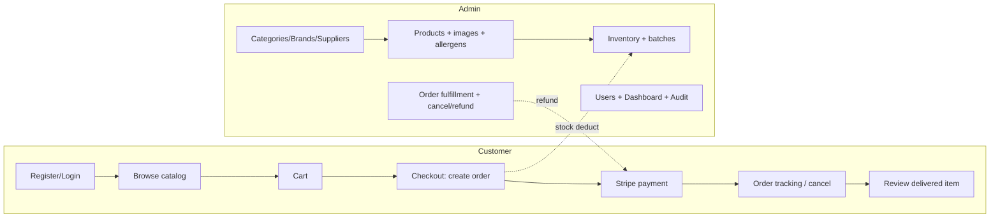
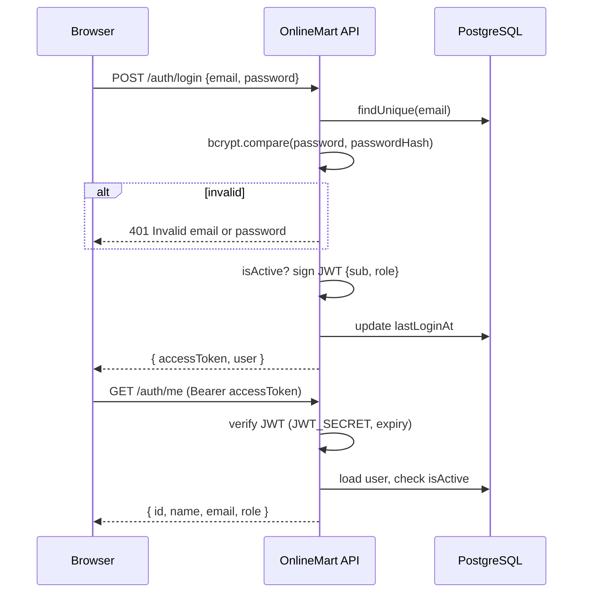
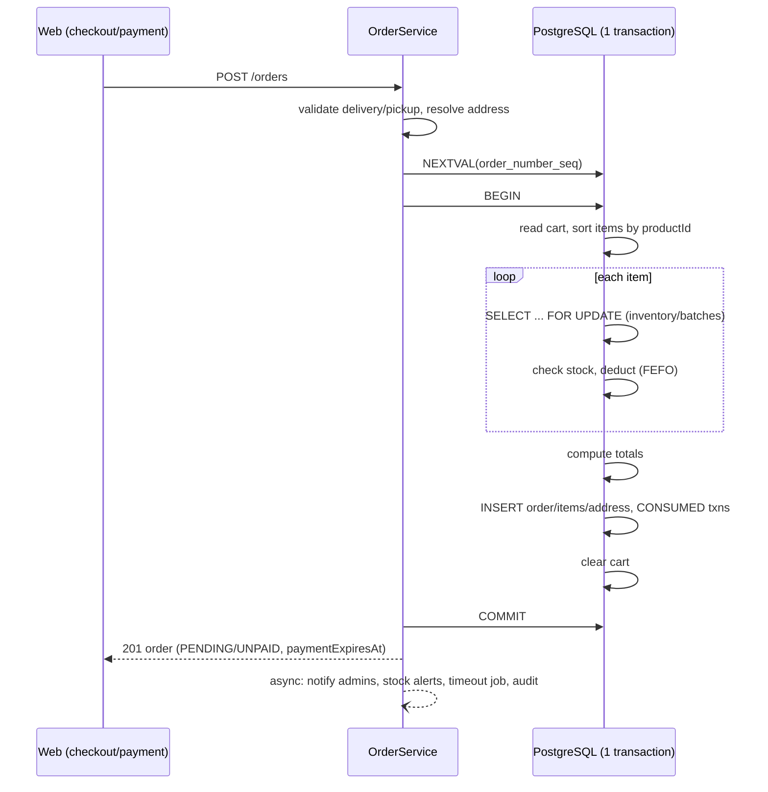
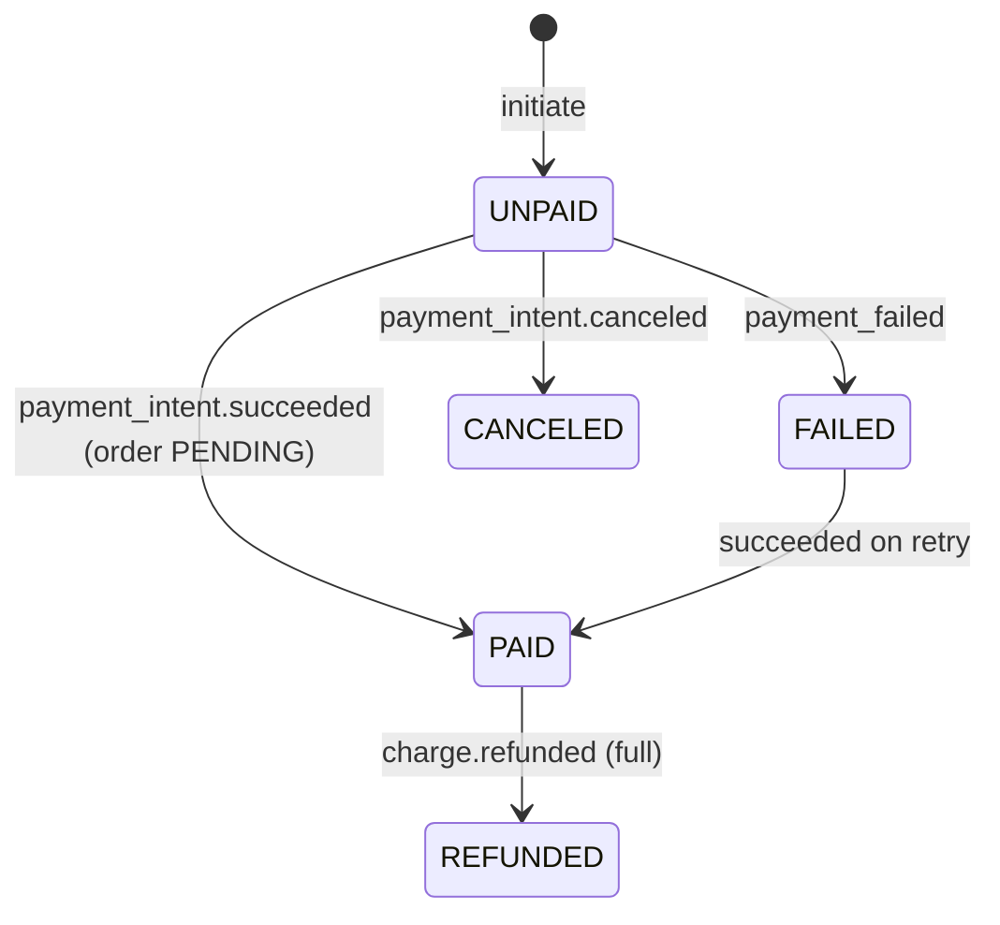
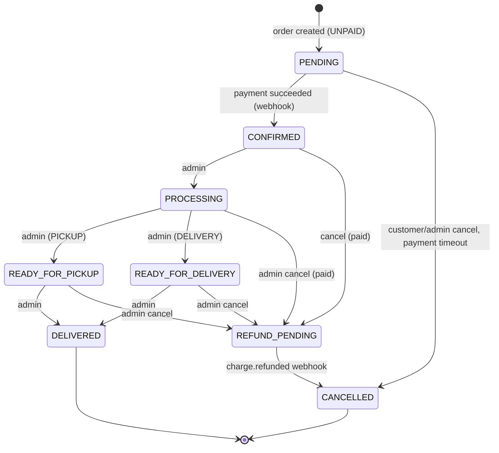
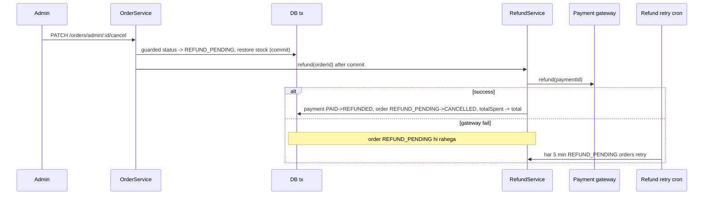

# 01 — Business Logic (Sab se Important Document)

> Yeh document **OnlineMart** ki **asal business logic** samjhata hai — woh rules jo reference projects `api` (NestJS backend) aur `web-app` (Next.js frontend) ke source code mein actually likhe hue hain. Is ko parh kar student bina code khole samajh sake ke system kya karta hai, kyun karta hai, aur usay khud kaise banana hai.

## Labels ka matlab

Har rule ke saath ek label laga hai taa ke pata chale baat kitni pakki hai:

| Label | Matlab |
|---|---|
| **[VERIFIED]** | Source code mein confirm kiya gaya hai (file reference saath diya gaya hai). |
| **[INFERRED]** | Code se andaza lagaya gaya hai, lekin product owner se confirm karna zaroori hai. |
| **[RECOMMENDED]** | Abhi implement nahi hai — improvement ki recommendation hai. |
| **[DESIGN]** | Project ka tay-shuda design decision (e.g. authentication backend khud handle karta hai). |

File references `api/src/...` (backend) aur `web-app/src/...` (frontend) se shuru hote hain.

---

## 1. Application kya karti hai? (Big Picture)

OnlineMart ek **UK-based online grocery store** hai (currency `GBP`, Stripe `gbp`, address country `GB`). Is ke do hisse hain:

1. **Customer storefront** — customer products browse karta hai, cart banata hai, order place karta hai (delivery ya pickup), card se Stripe ke through payment karta hai, order track/cancel karta hai, aur delivered item ka review deta hai.
2. **Admin panel** — admin categories, brands, suppliers, products, inventory (batch + expiry ke saath), reviews, users aur orders manage karta hai; dashboard aur audit log dekhta hai.

**Main actors:**

| Actor | Kaun hai | Verified source |
|---|---|---|
| Guest | Login ke baghair visitor — sirf public catalog dekh sakta hai | `@PublicRoute()` on `GET /products`, `GET /categories` |
| CUSTOMER | Registered customer | `UserRole.CUSTOMER` — `prisma/schema.prisma` |
| ADMIN | Store staff/admin | `UserRole.ADMIN` |
| SYSTEM | Cron jobs, queue processors, Stripe webhooks | `AuditActorType.SYSTEM_TRIGGER` |
| Stripe | External payment gateway | `payment/services/stripe.service.ts` |

> **Authentication [DESIGN]:** Login, registration, password hashing aur token issue karna — sab **backend khud** karta hai (JWT + bcrypt). Koi external identity provider nahi.

> **Important:** Project mein sirf **do roles** hain — `ADMIN` aur `CUSTOMER`. Business requirement **ek hi administrator** hai; yeh rule database level par enforce hota hai (dekhein [06-authentication-and-authorization.md](06-authentication-and-authorization.md)).

### Feature map

---

## 2. Cross-cutting rules (har feature par lagte hain)

### 2.1 Authentication guard [DESIGN] — `modules/auth/guards/jwt-auth.guard.ts`

Har protected request par yeh steps chalte hain (guard **global** hai — har route by default protected):

1. Agar route `@Public()` hai → foran allow.
2. `Authorization` header missing → **401** `Authorization header missing`.
3. `Bearer <token>` format nahi → **401** `Invalid authorization header format`.
4. Backend apne `JWT_SECRET` se token verify karta hai — expired → **401** `Token has expired. Please login again.`, ghalat signature → **401** `Invalid authentication token`.
5. Token ke `sub` (userId) se DB user nikalo. Na mile → **401**.
6. `isActive = false` → **403** `User account is deactivated. Please contact support.`
7. Role DB se liya jata hai (token se nahi), phir route ke `@Roles('ROLE')` check. Fail → **403** `Insufficient permissions`.

**Kyun?** Authentication (yeh kaun hai?) aur authorization (kya yeh yeh kaam kar sakta hai?) alag cheezein hain. Har request par DB check is liye hai taa ke **deactivated user ka purana token bhi kaam na kare** — JWT apni expiry tak valid rehta hai, lekin `isActive` ka check foran asar karta hai.

### 2.2 Customer-only guard [VERIFIED] — `common/guards/customer-only.guard.ts`

Cart sirf CUSTOMER ke liye hai. Cart controller par `CustomerOnlyGuard` laga hai jo `role !== CUSTOMER` par **403** deta hai — admin cart nahi bana sakta.

### 2.3 Validation [VERIFIED] — `main.ts`

Global `ValidationPipe({ whitelist: true, forbidNonWhitelisted: true, transform: true })`. Matlab: DTO mein jo field declare nahi, woh body mein aaye to **400** — is se **mass assignment** (jaise body mein `role: "ADMIN"` bhejna) block ho jata hai.

### 2.4 Error response shape [VERIFIED] — `filters/errors.exception.filter.ts`

- `HttpException` → NestJS ka standard `{ statusCode, message, error }`.
- Prisma `P2002` (unique) → **409** `Unique constraint violation`; `P2003` (FK) → **400**; `P2025` (not found) → **404**; baaki DB errors → **500** `Database error occurred`.
- Koi stack trace client ko nahi jata; 500 errors server log mein jate hain.

### 2.5 Rate limiting [VERIFIED] — `config/rate-limit.config.ts`, `common/guards/custom-throttler.guard.ts`

Global limit 150 requests/minute. Key = JWT ka `sub` (bina verify kiye, sirf bucket ke liye) warna IP. Tight limits: `PAYMENT` 5/min, `ORDER` (create/cancel) 20/min, `REVIEW` 20/min, `ADMIN_WRITE` 60/min, `ADMIN_IMAGE_UPLOAD` 30 per 5 min. GET routes zyada tar `@SkipThrottle()`.
**[INFERRED]** In-memory storage hai — multiple instances par limit per-instance hogi (code comment "SCALE: move to Redis store" khud yeh batata hai).

### 2.6 Money handling [VERIFIED] — `common/money/money.service.ts`

Database mein `Decimal(10,2)`. Saari arithmetic `Prisma.Decimal` → integer pence (Dinero.js) mein hoti hai; float kabhi use nahi hota. API responses mein money **string** hota hai (`"12.50"`). Shipping cost abhi hamesha `0` hai (`ORDER_SHIPPING_COST = 0`).

### 2.7 Audit log [VERIFIED] — `modules/audit/service/audit.service.ts`

Har important action (create/update/delete/status change) `audit_logs` mein likha jata hai — **fire-and-forget** (fail ho to sirf log, request fail nahi hoti). Admin `GET /audit-logs` se **aaj** ki activity dekh sakta hai.

### 2.8 Notifications [VERIFIED] — `modules/notification/services/notification.service.ts`

- In-app notification DB mein `upsert` hoti hai `(userId, referenceId, referenceEvent)` unique key par — **same event do baar aaye to duplicate notification nahi banti**.
- User preferences: `pushNotification` false → SSE push nahi; `emailNotification` false → email nahi.
- Email Bull queue (Redis) se SMTP2GO ke through Handlebars templates ke saath jati hai.
- Live notifications Server-Sent Events (`GET /notifications/stream`) se, 30 second heartbeat.
- **[INFERRED]** SSE streams in-memory `Map` mein hain — multiple server instances par ek instance ka publish doosre instance ke client tak nahi pohnchega.

### 2.9 External side effects (refund / payment cancel) [DESIGN]

Payment gateway ko refund ya payment-cancel ki call **DB transaction commit hone ke baad** hoti hai — transaction ke andar network call kabhi nahi (DB locks lambe waqt tak na rukein).

1. Transaction mein order ka status badalta hai (e.g. paid order → `REFUND_PENDING`) — yeh "refund baqi hai" ka record khud order hi hai.
2. Commit ke baad `RefundService` gateway ko refund call karta hai.
3. Call kamyab → payment `PAID → REFUNDED`, order `REFUND_PENDING → CANCELLED` (guarded update).
4. Call fail → order `REFUND_PENDING` hi rehta hai; ek **refund retry cron** (har 5 minute) aise orders dobara try karta hai.

**Kyun?** Agar DB commit ho jaye aur foran gateway call fail ho jaye to refund bhoolna nahi chahiye. `REFUND_PENDING` status + retry cron is ko simple tareeqe se reliable bana dete hain. Duplicate refund se bachne ke liye DB update `WHERE status = 'PAID'` guarded hota hai.

---

## 3. Feature: Customer Registration

1. **Feature name:** Customer sign-up (account creation)
2. **Business purpose:** Naya customer account banana taa ke woh cart aur orders bana sake.
3. **Actors:** Guest.
4. **Business rules [DESIGN]:**
   - Password backend receive karta hai aur **bcrypt** (cost 12) se hash karke `users.passwordHash` mein rakhta hai; plain password kabhi store, log ya return nahi hota.
   - [VERIFIED] Frontend Zod: full name required (trimmed), valid email, password min 8, confirm password match, terms accept (`modules/zod/register.model.ts`). Backend bhi password 8–72 chars validate karta hai (72 = bcrypt limit).
   - Backend hamesha `role: 'CUSTOMER'` set karta hai — DTO mein `role` field hai hi nahi, is liye client role choose nahi kar sakta.
   - [VERIFIED] Email DB mein unique hai — conflict par **409** `This email is already associated with another account.`
   - Email lowercase + trim karke save hoti hai.
5. **Preconditions:** Email pehle se registered na ho.
6. **Main workflow:**
   1. Customer form bharta hai → Zod validate karta hai.
   2. `POST /auth/register { name, email, password, phone? }`.
   3. Backend DTO validate → password hash → CUSTOMER row insert (`isActive = true`) → audit log.
   4. Response mein user (bina `passwordHash`) → frontend login page par bhejta hai (ya seedha login karwa deta hai).
7. **Alternative workflows:** Phone diya ho aur pehle se kisi aur ka ho → **409**.
8. **Failure scenarios:** 400 validation (weak/short password, invalid email), 409 email/phone conflict, 429 rate limit.
9. **Database impact:** `users` mein 1 row insert; `audit_logs` 1 row.
10. **API responsibilities:** `POST /auth/register`.
11. **Frontend responsibilities:** Form, Zod validation, toasts, redirect.
12. **Authorization rules:** Public endpoint, rate limited (10/min per IP). Role hamesha CUSTOMER.
13. **Concurrency:** Do parallel same-email registrations → `email` unique constraint ek ko 409 deta hai. Data consistent rehta hai.
14. **Duplicate request:** Same email dobara → 409, doosra account nahi banta.
15. **Acceptance criteria:**
    - Naya user register → `users.role = CUSTOMER`, `passwordHash` bcrypt hash hai (plain nahi).
    - Body mein `role: "ADMIN"` bhejo → **400** (`forbidNonWhitelisted`).
    - Same email dobara → **409**.
    - Response mein `passwordHash` nahi.

---

## 4. Feature: Login, Session aur Logout

1. **Feature name:** Login / session / logout
2. **Business purpose:** User ki identity confirm karna aur role ke hisaab se sahi area (admin ya shop) mein bhejna.
3. **Actors:** Customer, Admin.
4. **Business rules [DESIGN]:**
   - [VERIFIED] Zod: valid email, password required, `rememberMe` boolean (`login.model.ts`).
   - Backend email se user dhoondta hai aur `bcrypt.compare` se password check karta hai.
   - "Email nahi mila" aur "password ghalat" dono par **same** **401** `Invalid email or password` — taa ke koi pata na laga sake ke kaunsi email registered hai (user enumeration se bachao).
   - Deactivated account → **403** `User account is deactivated. Please contact support.`
   - Kamyab login par backend **JWT access token** sign karta hai: payload `{ sub: userId, role }`, secret `JWT_SECRET` (env, ≥32 chars), expiry `JWT_EXPIRES_IN` (e.g. `1d`). `lastLoginAt` update hota hai.
   - Role hamesha backend se aata hai (`GET /auth/me` / login response) — frontend role khud decide nahi karta.
   - Login endpoint rate limited (10/min per IP) — brute force se bachao.
5. **Preconditions:** Registered, active account.
6. **Main workflow:**
   1. `POST /auth/login { email, password }`.
   2. Backend verify → `{ accessToken, user }` return.
   3. Frontend token + user Zustand `auth-store` mein save (persist).
   4. Har agli API call par `Authorization: Bearer <accessToken>`.
   5. Admin → `/admin/dashboard`, Customer → `/shop`.
   6. Admin/customer layouts ka `AuthGuard` mount par `GET /auth/me` se role verify karta hai.
7. **Alternative workflows:** Token expire ho jaye → backend **401** → frontend store clear karke `/login` par bhejta hai.
8. **Failure scenarios:** Ghalat credentials → 401 generic; inactive → 403; bahut attempts → 429.
9. **Database impact:** `users.lastLoginAt` update.
10. **API responsibilities:** `POST /auth/login`, `GET /auth/me`.
11. **Frontend responsibilities:** Form, token store, redirect, `AuthGuard` route protection, 401 handling in `request()`.
12. **Authorization rules:** `/admin/*` pages par non-admin → redirect. Frontend gating sirf UX hai — asli protection backend guard hai.
13. **Concurrency:** Login stateless hai (token server par store nahi hota), parallel logins safe.
14. **Duplicate request:** Dobara login safe hai (har dafa naya token, koi side effect nahi siwaye `lastLoginAt`).
15. **Logout:** Frontend token aur user store se delete karta hai + local cart state reset. Token stateless hai, is liye apni expiry tak technically valid rehta hai — is ka risk short expiry aur har request par `isActive` check se kam hota hai. **[RECOMMENDED]** Foran revoke chahiye ho to `users.tokenVersion` column: logout/password change par increment, guard token ka version compare kare.
16. **Acceptance criteria:** Customer login → `/shop`; admin login → `/admin/dashboard`; ghalat email aur ghalat password ka same error; deactivated user → har API **403**; expired token → 401 → login page; customer `/admin/...` khole → redirect.

---

## 5. Feature: Roles, Admin account aur Customer status

1. **Feature name:** Admin account + customers ko activate/deactivate karna
2. **Business purpose:** Store ko ek admin chalaye, aur ghalat/abusive customer accounts block kiye ja sakein.
3. **Actors:** ADMIN.
4. **Business rules:**
   - Project mein sirf **do roles** hain: `ADMIN` aur `CUSTOMER`.
   - Admin account koi API endpoint nahi banata — sirf seed script (`scripts/create-admin.ts` style) env values (`ADMIN_EMAIL`, `ADMIN_PASSWORD`, `ADMIN_NAME`) se banata hai. Script admin pehle se ho to dobara nahi banata.
   - [VERIFIED] `PATCH /user/:id/status` (ADMIN): apna status change nahi kar sakta → **400**; target CUSTOMER na ho → **403**.
   - [VERIFIED] `GET /user/list` (ADMIN): search name/email/phone, filter role/isActive, `includeDeleted` default false, pagination.
   - Koi bhi endpoint kisi user ka role change nahi karta.
5. **Preconditions:** Requester authenticated ADMIN.
6. **Main workflow (status):** Admin customer list kholta hai → toggle → backend checks → `users.isActive` update → audit log.
7. **Alternative workflows:** Deactivated customer ko dobara activate karna (same endpoint, `isActive: true`).
8. **Failure scenarios:** 400 self-change, 403 admin target, 404 user missing.
9. **Database impact:** `users` update; `audit_logs`.
10. **API responsibilities:** `GET /user/list`, `PATCH /user/:id/status`.
11. **Frontend responsibilities:** `app/admin/customers` — table, filters, status toggle modal.
12. **Authorization rules:** Sirf ADMIN.
13. **Concurrency:** Status toggle ek single update hai — do parallel same requests same nateeja dete hain.
14. **Duplicate request:** Same status dobara set karna safe hai — nateeja wahi rehta hai.
15. **Acceptance criteria:** Admin khud ko deactivate kare → 400; admin target → 403; deactivated customer ki agli request → 403.

---

## 6. Feature: Profile update aur Account deletion

1. **Feature name:** Profile edit / self-delete
2. **Business purpose:** Customer apni info update kare; GDPR-style apna account delete kar sake, lekin order history (accounting) bachi rahe.
3. **Actors:** Customer (delete sirf CUSTOMER), Customer/Admin (update).
4. **Business rules:**
   - [VERIFIED] `PUT /user` sirf `name`, `phone` update karta hai; phone unique — conflict **409** `This mobile number is already associated with another account.`
   - [VERIFIED] `DELETE /user` (`@Auth('CUSTOMER')`) **hard delete nahi** — anonymize: email `"[DELETED] <id>:<email>"`, phone null, `isActive=false`, `deletedAt=now`; addresses, cart, notifications, preferences delete; orders/reviews rehte hain.
   - `passwordHash` bhi random value se replace kar diya jata hai, taa ke purane password se login kabhi na ho sake.
   - [VERIFIED] API responses mein `[DELETED]` prefix strip hota hai (`stripDeletedEmailPrefix`).
5. **Preconditions:** Authenticated.
6. **Main workflow (delete):** Confirm modal → `DELETE /user` → 1 transaction (deletes + anonymize) → 204 → frontend logout.
7. **Alternative workflows:** Delete ke baad purana token → guard `isActive = false` dekh kar 403 deta hai.
8. **Failure scenarios:** 404, 500 (transaction rollback — kuch bhi half-done nahi).
9. **Database impact:** `users` update, 4 tables delete.
10. **API responsibilities:** `PUT /user`, `DELETE /user`.
11. **Frontend responsibilities:** `EditProfileForm`, `DeleteAccountModal` (confirmation).
12. **Authorization rules:** Sirf apna account (`CurrentDbUser` — id body/URL se nahi aati, is liye IDOR possible nahi).
13. **Concurrency:** Transaction atomic.
14. **Duplicate request:** Dobara delete → user ab inactive hai, guard 403 dega.
15. **Acceptance criteria:** Delete ke baad login → 403; admin order list mein purane orders customer naam ke saath dikhte hain.

---

## 7. Feature: Address book

1. **Feature name:** Saved addresses
2. **Business purpose:** Checkout tez karna — customer saved address chun sake.
3. **Actors:** Customer (aur Admin bhi, kyunke controller `@Auth('CUSTOMER','ADMIN')` hai).
4. **Business rules:**
   - [VERIFIED] Fields: `addressLine` ≤100, `city` ≤30, `county` ≤30, `postcode` ≤20, `latitude` −90..90, `longitude` −180..180 (required), `buildingType` optional, `label` HOME/WORK.
   - [VERIFIED] Ek user ka **sirf ek default address** — DB partial unique index `addresses_userId_default_unique ... WHERE "isDefault" = true` (migration `20260712090000`).
   - [VERIFIED] Naya address `isDefault: true` ho to baaki default unset honge pehle.
   - [VERIFIED] Default address delete ho to sab se naya address default ban jata hai.
   - [VERIFIED] Ownership: har query `{ id, userId }` composite par — doosre user ka address id bhejo → **404** (403 nahi — taake existence leak na ho).
5. **Preconditions:** Authenticated.
6. **Main workflow:** `POST /user/address` → list `GET /user/address` (default pehle) → `PUT`/`DELETE`/`PATCH /:id/default`.
7. **Alternative workflows:** Order mein inline `shippingAddress` bhi bheja ja sakta hai (saved nahi hota).
8. **Failure scenarios:** Race mein do default → partial unique index **409**.
9. **Database impact:** `addresses` CRUD.
10. **API responsibilities:** 6 address endpoints (`user.controller.ts`).
11. **Frontend responsibilities:** `AddressBook.tsx`, `useAddressManagement.ts`, map picker (Google Maps) lat/long dene ke liye.
12. **Authorization rules:** Ownership composite key.
13. **Concurrency:** **[INFERRED — gap]** "Unset old default → create new" do alag statements hain, transaction mein nahi; agar doosra fail ho to user ka koi default nahi rahega. DB index invariant (max 1 default) bachata hai, lekin "at least 1 default" nahi. **[RECOMMENDED]** Transaction mein wrap karein (student project yahi karta hai).
14. **Duplicate request:** Pehle se default address dobara set karo → wahi address return, koi change nahi.
15. **Acceptance criteria:** Doosre user ka address GET → 404; do addresses `isDefault:true` → sirf aakhri default.

---

## 8. Feature: Category management

1. **Feature name:** Category hierarchy
2. **Business purpose:** Catalog ko tree (e.g. Fruits → Citrus → Oranges) mein organize karna.
3. **Actors:** Admin (write), Guest (read).
4. **Business rules (`category.db.service.ts`):**
   - [VERIFIED] Max depth 3 levels (`CATEGORY_MAX_DEPTH = 2`, depth 0..2).
   - [VERIFIED] Name aur slug **globally unique** (migration `20260903000000_category_name_slug_global_unique`); slug name se generate.
   - [VERIFIED] Materialized `path` (e.g. `/fruits/citrus/`) descendants dhoondne ke liye.
   - [VERIFIED] Jis parent ke paas products hain us ke neeche subcategory nahi ban sakti → **409**.
   - [VERIFIED] `bestCategory` (featured) sirf top-level, aur max **4** → **400**.
   - [VERIFIED] Re-parent: khud apna parent nahi; descendant ko parent nahi (circular); naye parent ke paas products na hon; poore subtree ki depth limit check.
   - [VERIFIED] Product sirf **leaf + active** category mein assign hota hai (`category.service.ts ensureLeafAndActive`).
   - [VERIFIED] Delete: children ya products hon → FK error → **409**.
   - [VERIFIED] Image upload: S3 (Cloudflare R2) pehle, phir DB; DB fail par uploaded file rollback; purani image best-effort delete.
5. **Preconditions:** Admin.
6. **Main workflow:** Create → (optional) image → list (public, filters: search, bestCategory, isActive, parentId, depth, isLeaf).
7. **Alternative workflows:** Re-parent par descendant paths ek raw SQL `UPDATE ... WHERE path LIKE old%` se update.
8. **Failure scenarios:** 404 parent, 409 duplicate/has products, 400 depth/best limit.
9. **Database impact:** `categories` insert/update (subtree), `products.categoryId` move (re-parent case).
10. **API:** `POST/GET/GET :id/PATCH/DELETE /categories`, `POST/DELETE /categories/:id/image`.
11. **Frontend:** `app/admin/category/*`, public `CategoryAccordionSidebar`, `BestCategories`.
12. **Authorization:** Write ADMIN; read public.
13. **Concurrency:** Create/update `$transaction` mein; best-category count check transaction ke andar (**[INFERRED]** default READ COMMITTED isolation mein do parallel creates 5th best bana sakte hain).
14. **Duplicate request:** Duplicate name unique constraint se 409.
15. **Acceptance:** 4th level create → 400; 5th best → 400; products wali category ke neeche child → 409.

---

## 9. Feature: Product management

1. **Feature name:** Product catalog CRUD (+ images, allergens)
2. **Business purpose:** Bechne wali cheezon ki information, price, order limits aur dietary/allergen info.
3. **Actors:** Admin.
4. **Business rules (`products.service.ts`, `products.dto.ts`):**
   - [VERIFIED] Required: name ≤100, categoryId (leaf+active), `priceCollection` ≥0.01 (2 decimals), min/max order qty ≥1, `storageType` (AMBIENT/CHILLED/FROZEN), `shelfLifeDays` ≥1, `unitOfMeasure`.
   - [VERIFIED] `maximumOrderQuantity >= minimumOrderQuantity` → warna **400**.
   - [VERIFIED] Name per category unique — app check + DB `@@unique([name, categoryId])`.
   - [VERIFIED] Barcode (≤14) unique.
   - [VERIFIED] Slug `<categorySlug>-<nameSlug>[-n]`; SKU `<CAT3>-<000001>` DB sequence `product_sku_seq` se (race-safe).
   - [VERIFIED] `batchTracked` true → false tab tak nahi jab tak ACTIVE batches hain → **400**.
   - [VERIFIED] Images: max 3, ek hi primary, sortOrder 0–2, 5 MB, real MIME (magic bytes) JPEG/PNG/WEBP/ICO; akeli image ka primary hataya nahi ja sakta.
   - [VERIFIED] Allergens: 14 UK allergen types, presence CONTAINS/MAY_CONTAIN/FREE_FROM, per product unique.
   - [VERIFIED] Delete: images + product transaction mein; agar orders/cart/inventory reference karein → **409**.
5. **Preconditions:** Category exists (leaf, active); brand optional.
6. **Main workflow:** Multi-step form (basic → pricing → inventory → media → review) → `POST /products` → `POST /products/:id/images` (multipart).
7. **Alternative workflows:** Update `PUT /products/:id` (partial fields), activate/deactivate via `isActive`.
8. **Failure scenarios:** 409 duplicate name/barcode, 400 qty, 404 category/brand.
9. **Database impact:** `products`, `product_images`, `product_allergens`.
10. **API:** `POST/PUT/GET/DELETE /products`, images + allergens sub-routes.
11. **Frontend:** `components/admin/products/*` (`ProductFormFrame` + `TAB_FIELDS` + `validateTab`), `modules/zod/product.model.ts`.
12. **Authorization:** ADMIN only (writes).
13. **Concurrency:** [VERIFIED] Comment: 5 parallel creates same name → 1 success, baaki 409 (DB unique bachata hai).
14. **Duplicate request:** Same name dobara → unique constraint se 409.
15. **Acceptance:** max<min → 400; same name same category → 409; parent category → 400.

---

## 10. Feature: Product browsing (public)

1. **Feature name:** Shop / catalog listing
2. **Business purpose:** Guest aur customer products search/filter/sort karke dekh saken.
3. **Actors:** Guest, Customer.
4. **Business rules:**
   - [VERIFIED] `GET /products` aur `GET /products/:id` `@PublicRoute()`.
   - [VERIFIED] Filters: `q` (name/sku/description, case-insensitive), categoryId, brandId, storageType, batchTracked, min/maxPrice (min>max → **400**), isActive, allergens; sort: `a_z`, `z_a`, `price_low_to_high`, `price_high_to_low`, `recents`, `best_selling` (**[VERIFIED]** abhi `updatedAt desc` fallback — TODO).
   - [VERIFIED] Pagination `page ≥1`, `limit 1..100`, default 10.
   - **[VERIFIED — gap]** Backend public listing par `isActive`/`isVisible` **force nahi** karta — frontend khud `isActive=true` bhejta hai (`services/public/products/public.ts`). Matlab koi bhi direct API call se inactive products dekh sakta hai. **[RECOMMENDED]** Public route par server-side `isActive: true, isVisible: true` lagayein (student project yahi karta hai).
5–15. Read-only feature: DB impact nahi; cacheable (TanStack Query `staleTime` 5 min); duplicate calls safe; retry safe. Frontend: `ProductListing.tsx`, `ShopSidebar`, `PriceFilter`, `SortBy`, `useDebounce` search. Acceptance: inactive product shop mein na dikhe.

---

## 11. Feature: Inventory management

1. **Feature name:** Stock (inventory) + adjustments + transaction ledger
2. **Business purpose:** Har product ka on-hand stock track karna, stock status (IN/LOW/OUT) dikhana, aur har movement ka audit trail rakhna.
3. **Actors:** Admin; System (orders, batch expiry).
4. **Business rules (`inventory.service.ts`, `inventory.db.service.ts`):**
   - [VERIFIED] Har product ki **ek hi** inventory row (`productId @unique`); dobara → **409**.
   - [VERIFIED] Batch-tracked product ke liye create karte waqt `batch.expiryDate` zaroori; non-batch ke liye mana.
   - [VERIFIED] Expiry date aaj ya future (end-of-day tak valid) — warna **400**.
   - [VERIFIED] `lowStockThreshold` default 10.
   - [VERIFIED] Stock status formula (`refreshInventoryStatus`): available = (batchTracked ? sum of ACTIVE non-expired batches : qtyOnHand); `≤0 → OUT_OF_STOCK`, `≤ threshold → LOW_STOCK`, warna `IN_STOCK`.
   - [VERIFIED] Adjustment: quantity ≠ 0 (negative = decrease); `DAMAGE` aur `RETURN_TO_SUPPLIER` sirf negative; result negative nahi ho sakta → **400**; batch-tracked ke liye `batchId` zaroori, batch ACTIVE aur same product ka ho.
   - [VERIFIED] Har movement `inventory_transactions` mein: RECEIVED, ADJUSTMENT_INCREASE/DECREASE, CONSUMED (order), RELEASED (cancel).
   - [VERIFIED] Status change (LOW/OUT) par admins ko notification (`dispatchStockNotification`).
5. **Preconditions:** Product exists.
6. **Main workflow (adjust):** Admin modal → `POST /inventory/adjustments` → `SELECT ... FOR UPDATE` inventory (aur batch) → check → update → transaction row → status refresh → commit.
7. **Alternative workflows:** `PATCH /inventory/:id` sirf `lowStockThreshold` ya batch expiry change.
8. **Failure scenarios:** 404, 400 negative stock.
9. **Database impact:** `inventory`, `inventory_batches`, `inventory_transactions`.
10. **API:** `GET /inventory`, `GET /inventory/available-products`, `GET /inventory/transactions(/export)`, `GET/PATCH /inventory/:id`, `POST /inventory`, `POST /inventory/adjustments`.
11. **Frontend:** `app/admin/inventory/*`, `app/admin/inventory-transactions/*` (CSV export client-side pages loop karta hai).
12. **Authorization:** ADMIN.
13. **Concurrency:** [VERIFIED] Row lock `FOR UPDATE` + `RepeatableRead`; DB CHECK `qtyOnHand >= 0` (batches par, migration `20260306100853`).
14. **Duplicate request:** Har call ek naya adjustment banati hai — frontend submit button pending mein disabled rakhe taa ke double click se do adjustments na banein.
15. **Acceptance:** `DAMAGE` +5 → 400; 10 stock par −11 → 400; same key do baar → ek hi transaction row.

---

## 12. Feature: Batches, FEFO aur Expiry

1. **Feature name:** Inventory batches (expiry tracking)
2. **Business purpose:** Grocery (perishable) items expire hote hain — pehle expire hone wala stock pehle bikna chahiye (**FEFO: First Expiry First Out**), aur expired stock sellable na rahe.
3. **Actors:** Admin, System cron.
4. **Business rules:**
   - [VERIFIED] `POST /batches` sirf batch-tracked products; qty ≥1; expiry aaj/future; batch code auto `BATCH-YYYYMMDD-XXXXXXXXXXXX`.
   - [VERIFIED] Order par batches `expiryDate ASC` order mein lock (`FOR UPDATE`) aur allocate hote hain (`order.db.service.ts allocateFefo`).
   - [VERIFIED] Cron har 5 min: expired ACTIVE batches → `EXPIRED`, inventory qty minus, `ADJUSTMENT_DECREASE` transaction, status refresh (`batch-expiry.cron.ts`).
   - [VERIFIED] Cancel par restore sirf ACTIVE batches mein; expired batch restore skip (warna expired cheez dobara bikne lagti).
5–15. DB impact: `inventory_batches`, `inventory`, `inventory_transactions`. Concurrency: guarded `updateMany(where status=ACTIVE)` — do cron instances ek batch do baar expire nahi kar sakte. Acceptance: kal expire hone wala batch pehle consume ho.
   - **[INFERRED — inconsistency]** Cancel par aggregate `inventory.qtyOnHand` poori quantity se credit hoti hai chahe kuch batches expired hon (code comment khud yeh batata hai). Status calculation batch sum use karti hai, is liye selling par asar nahi, lekin `qtyOnHand` number misleading ho sakta hai.

---

## 13. Feature: Cart

1. **Feature name:** Shopping cart
2. **Business purpose:** Order se pehle items jama karna; server-side cart taa ke devices ke darmiyan same rahe.
3. **Actors:** CUSTOMER only.
4. **Business rules (`cart.service.ts`, `cart.db.service.ts`):**
   - [VERIFIED] Har user ki **ek** cart (`carts.userId @unique`), `GET /cart` upsert se bana deta hai.
   - [VERIFIED] Product active + visible ho, warna **404**; OUT_OF_STOCK → **400**.
   - [VERIFIED] Pehli dafa add par quantity ≥ `minimumOrderQuantity`.
   - [VERIFIED] Total quantity ≤ min(stock, `maximumOrderQuantity`) — check **upsert ke baad, transaction ke andar**; fail par rollback.
   - [VERIFIED] Same product dobara add → quantity increment (`@@unique([cartId, productId])`).
   - [VERIFIED] Har add/update par price refresh (cart item price = current product price).
   - [VERIFIED] `PUT /cart/items/:id` quantity 0 → item delete.
   - [VERIFIED] Ownership: item ki cart user ki cart na ho → **404**.
   - [VERIFIED] Response mein har item ka `isAvailable`, `maxAllowedQuantity`; totals `subtotal` aur `grandTotal`.
5. **Preconditions:** Logged-in customer.
6. **Main workflow:** Add → `POST /cart/items` → full cart response.
7. **Alternative:** Frontend optimistic update + 350 ms debounce per item (`stores/shop-store.ts`) — spam clicks ek API call ban jate hain.
8. **Failure:** 400 limits/stock, 404 product.
9. **DB impact:** `carts`, `cart_items`.
10. **API:** `GET/DELETE /cart`, `POST /cart/items`, `PUT/DELETE /cart/items/:item_id`.
11. **Frontend:** `CartPanel`, `CartCounter`, `CartSidebar`, Zustand shop store, `useGetCart`.
12. **Authorization:** CUSTOMER + `CustomerOnlyGuard`.
13. **Concurrency:** Upsert unique key + transaction max check.
14. **Duplicate request:** **Add increment karta hai** — dobara request se quantity badh jati hai (max limit tak). Update (absolute quantity) dobara bhejna safe hai.
15. **Acceptance:** Stock 5, max 10 → 6 add → 400 "Only 5 units available"; admin `GET /cart` → 403.
   - **Note:** Cart **stock reserve nahi karta** — stock sirf order create par deduct hota hai (purana reservation system hata diya gaya — migration `20260818091000_drop_reservation_tables_and_columns`).

---

## 14. Feature: Checkout — Order creation (sab se critical workflow)

1. **Feature name:** Place order
2. **Business purpose:** Cart ko ek firm order mein badalna, stock deduct karna, price lock karna, aur payment ke liye tayyar karna.
3. **Actors:** CUSTOMER.
4. **Business rules (`order.service.ts`, `order.db.service.ts`):**
   - [VERIFIED] `deliveryType` DELIVERY ya PICKUP.
   - [VERIFIED] DELIVERY: `addressId` (saved, apna) **ya** inline `shippingAddress` — dono nahi, koi ek zaroori; `pickupScheduledAt` mana.
   - [VERIFIED] PICKUP: `pickupScheduledAt` zaroori; address mana.
   - [VERIFIED] Cart khali → **400** `Cart is empty. Cannot create order.`
   - [VERIFIED] Har product active ho → warna **400** `Product is no longer available.`
   - [VERIFIED] Order number `ORD-<YEAR>-<000001>` DB sequence se.
   - [VERIFIED] **Price server se** — cart item price nahi, `product.priceCollection` current value (client ki price par bharosa nahi).
   - [VERIFIED] Status `PENDING`, payment `UNPAID`, `paymentExpiresAt = now + 5 minute`.
   - [VERIFIED] Stock **order create par hi deduct** hota hai (reservation nahi).
   - [VERIFIED] Cart items delete — same transaction.
   - Order total = subtotal + shippingCost (abhi shipping 0).
5. **Preconditions:** Customer logged in, cart mein items, stock available.
6. **Main workflow:**
   1. Delivery/pickup validation; saved address resolve (ownership check).
   2. Order number sequence se.
   3. **Ek DB transaction:**
      1. Cart + items + products read.
      2. Items `productId` se **sort** (deadlock se bachne ke liye deterministic lock order).
      3. Har item: batch-tracked → batches `FOR UPDATE` + FEFO allocate + deduct; warna inventory row `FOR UPDATE` + check + deduct. Kam stock → **400** `Not enough stock. Requested: X, Available: Y.`
      4. Subtotal = Σ(price × qty) (Dinero, pence); total = subtotal + shipping.
      5. Order + items + address create.
      6. Har item ka `CONSUMED` inventory transaction (orderItemId ke saath) + stock status refresh.
      7. Cart clear.
   4. Commit ke baad (fire-and-forget): admins ko "new order" notification, LOW/OUT stock notifications, Bull delayed job (payment timeout), audit log.
7. **Alternative workflows:** Saved address ki jagah inline `shippingAddress` (address book mein save nahi hota).
8. **Failure scenarios:** 400 validation/stock, 404 address, 500 → transaction rollback (stock aur cart sab wapas jaise the).
9. **Database impact:** `orders`, `order_items`, `order_addresses`, `inventory`/`inventory_batches` update, `inventory_transactions`, `cart_items` delete.
10. **API:** `POST /orders` → `ICreateOrderResponse`.
11. **Frontend (`app/checkout/*`):** CheckoutForm address/delivery + Zod → "Confirm & Pay" par **order abhi nahi banta** — sirf "order intent" `sessionStorage` (`checkout_order_intent`) mein save → `/checkout/payment` par "Pay Now" dabane par `POST /orders` (button pending mein disabled) → `POST /payments/initiate` → payment fail ho to frontend order cancel karta hai (`reason: OTHER`).
12. **Authorization:** Sirf CUSTOMER (`@Auth('CUSTOMER')`); admin → **403**.
13. **Concurrency:** [VERIFIED] Row locks + sorted lock order + DB CHECK; k6 race tests (`k6/race-create-order.js`, `k6/race-checkout.js`) — 1 unit stock, 2 customers → ek kamyab, doosre ko 400.
14. **Duplicate request:** Har `POST /orders` ek naya order banata hai. Cart order ke saath hi khali ho jata hai, is liye foran dobara bheji gayi request ko aam taur par **400 `Cart is empty`** milta hai. Frontend "Pay Now" button pending mein disabled rakhta hai.
15. **Acceptance:** Order ke baad cart khali; turant dobara order → 400 `Cart is empty`; stock 1 + 2 parallel orders → 1 success; PICKUP bina date → 400.

---

## 15. Feature: Payment initiation (Stripe PaymentIntent)

1. **Feature name:** Initiate payment
2. **Business purpose:** PENDING order ke liye Stripe PaymentIntent banana aur browser ko `clientSecret` dena (card details hamare server se kabhi nahi guzarte).
3. **Actors:** CUSTOMER.
4. **Business rules (`payment.service.ts`):**
   - [VERIFIED] Order customer ka ho aur `PENDING` ho → warna **404**.
   - [VERIFIED] Total > 0.
   - [VERIFIED] Agar UNPAID payment pehle se hai → **wahi** intent wapas (retrieve), naya nahi.
   - [VERIFIED] Ek order ka hamesha ek hi PaymentIntent — UNPAID payment pehle se ho to wahi reuse hota hai.
   - [VERIFIED] Amount pence mein server ka `order.total` — client amount nahi bhejta.
   - [VERIFIED] Payment row: method CREDIT_CARD, provider STRIPE, `gatewayRef` (unique) = PaymentIntent id, status UNPAID.
   - [VERIFIED] Rate limit 5/min.
5. **Preconditions:** PENDING order.
6. **Main workflow:** `POST /payments/initiate {orderId}` → intent → `{ clientSecret, paymentIntentId }` → frontend Stripe Elements `confirmPayment`.
7. **Alternative:** "Continue payment" (order history se) — same endpoint, existing intent milta hai.
8. **Failure:** 404, 400 zero total, Stripe error.
9. **DB impact:** `payments` insert.
10. **API:** `POST /payments/initiate`.
11. **Frontend:** `StripePaymentSection`, `services/payments/index.ts`.
12. **Authorization:** CUSTOMER, apna order.
13. **Concurrency:** **[INFERRED]** Do parallel initiate dono "no existing payment" dekh sakte hain; `gatewayRef @unique` doosri payment row ko 409 par rok deta hai.
14. **Duplicate request:** Existing UNPAID payment reuse hoti hai — dobara initiate naya payment nahi banata.
15. **Acceptance:** Same order 3 dafa initiate → 1 payment row, same `paymentIntentId`.

---

## 16. Feature: Payment webhooks (confirm / fail / cancel / refund)

1. **Feature name:** Stripe webhook processing
2. **Business purpose:** Payment ka asal nateeja Stripe batata hai — browser ki "success" par bharosa nahi kiya jata.
3. **Actors:** Stripe (System).
4. **Business rules:**
   - [VERIFIED] `POST /webhooks/payments/stripe` raw body + `stripe-signature` verify (`constructEventAsync`) → invalid → **400**.
   - [VERIFIED] Controller sirf **Bull queue mein job daalta hai** aur foran 200 deta hai; processing worker karta hai (3 attempts, exponential backoff).
   - [VERIFIED] `payment_intent.succeeded` → transaction (RepeatableRead): payment UNPAID/FAILED **aur** order PENDING ho to: payment PAID, order `CONFIRMED` + `paymentStatus PAID` + `confirmedAt`, user `totalOrders +1`, `totalSpent += total`. Phir timeout job remove, customer + admin notifications.
   - [VERIFIED] Payment pehle se PAID → skip (dobara process nahi hoti).
   - [VERIFIED] **Late payment:** order pehle hi cancel (timeout) ho chuka aur payment ab succeed hui → payment PAID mark + commit ke baad **automatic refund** (`RefundService`; fail ho to retry cron) + audit.
   - [VERIFIED] `payment_intent.payment_failed` → UNPAID → FAILED (+ reason), notification. Order PENDING hi rehta hai (customer retry kar sakta hai — FAILED payment bhi confirm ho sakti hai).
   - [VERIFIED] `payment_intent.canceled` → UNPAID → CANCELED.
   - [VERIFIED] `charge.refunded` → sirf **full refund** (partial → skip + log for manual review); payment PAID → REFUNDED, order `REFUND_PENDING → CANCELLED`, `paymentStatus REFUNDED`, `totalSpent −= total`.
5. **Preconditions:** Payment row `gatewayRef` se mile (na mile → warn + ignore).
6–7. Upar.
8. **Failure:** Job fail → Bull retry; handlers guarded updates ki wajah se retry safe.
9. **DB impact:** `payments`, `orders`, `users` (stats).
10. **API:** Webhook endpoint (public, signature-protected, throttle skip).
11. **Frontend:** Order confirmation page `paymentConfirmed` flag se "Payment Received" dikhata hai jab tak webhook catch up kare.
12. **Authorization:** Signature verification hi authorization hai.
13. **Concurrency:** Har state change `WHERE status = expected` guarded — Stripe ka duplicate delivery double count nahi karta.
14. **Duplicate request:** [VERIFIED] Status guards — same event N baar = ek effect.
15. **Acceptance:** Same `payment_intent.succeeded` 2 dafa → `totalOrders` sirf +1.

---

## 17. Feature: Payment timeout auto-cancel

1. **Feature name:** Unpaid order expiry
2. **Business purpose:** Order create par stock deduct ho jata hai; agar customer pay na kare to stock hamesha ke liye block na rahe.
3. **Actors:** System.
4. **Business rules:**
   - [VERIFIED] `ORDER_PAYMENT_TIMEOUT_MINUTES = 5`.
   - [VERIFIED] Primary: Bull delayed job (`jobId = orderId`, 10 attempts). Backstop: cron har 5 min `status=PENDING AND paymentExpiresAt < now` (50 per run).
   - [VERIFIED] Cancel `PAYMENT_TIMEOUT` reason se, sirf `PENDING` source status se; stock restore; commit ke baad UNPAID payment ko gateway par cancel (best-effort — fail ho to bhi order cancel rehta hai; baad mein aane wali late payment auto-refund ho jati hai).
   - [VERIFIED] Payment confirm hone par job remove hota hai; agar phir bhi chale to `PENDING` guard 409 deta hai jise skip kiya jata hai.
5–15. Concurrency: job + cron dono chal jayen → atomic `updateMany where status in [PENDING]` sirf ek ko jitata hai. Acceptance: order bana kar 5 min wait → CANCELLED, stock wapas.

---

## 18. Feature: Customer order cancellation

1. **Feature name:** Customer cancels own order
2. **Business purpose:** Processing shuru hone se pehle customer order wapas le sake.
3. **Actors:** CUSTOMER.
4. **Business rules:**
   - [VERIFIED] Sirf `PENDING` ya `CONFIRMED` → warna **400** `Order cannot be cancelled once it is in <status>...`.
   - [VERIFIED] Reason enum: CHANGED_MIND, ORDERED_BY_MISTAKE, FOUND_BETTER_PRICE, DELIVERY_TOO_LONG, OTHER; `OTHER` par `note` zaroori (≤500).
   - [VERIFIED] Already CANCELLED → 200 `Order is already cancelled.` (dobara cancel safe).
   - Paid order → status `REFUND_PENDING`, `totalOrders −1`, commit ke baad refund (feature 20 ka flow). Unpaid → `CANCELLED`, commit ke baad UNPAID payment gateway par cancel (best-effort).
   - [VERIFIED] Stock restore: CONSUMED transactions se exact quantities wapas + RELEASED transactions.
5. **Preconditions:** Apna order.
6. **Main workflow:** `CustomerCancelOrderModal` (confirm checkbox) → `PATCH /orders/:id/cancel` → transaction → notification/email.
8. **Failure:** 404 (doosre ka order — IDOR), 400 status, 409 status race.
9. **DB:** `orders`, `inventory*`, `inventory_transactions`, `users`, `payments`.
12. **Authorization:** `findFirst({ id, userId })` ownership.
13. **Concurrency:** Atomic guarded update `WHERE id AND userId AND status IN (...)` → admin same waqt PROCESSING kare to customer ko 409.
14. **Duplicate request:** Already cancelled → success message; refund guarded update (`WHERE status = 'PAID'`) se double refund nahi hota.
15. **Acceptance:** PROCESSING order cancel → 400; doosre customer ka order id → 404.

---

## 19. Feature: Admin order fulfillment (status transitions)

1. **Feature name:** Order status workflow
2. **Business purpose:** Warehouse/delivery progress track karna aur customer ko notify karna.
3. **Actors:** ADMIN.
4. **Business rules (`order.types.ts ADMIN_ALLOWED_TRANSITIONS`):**

   | Current | Allowed next (admin) |
   |---|---|
   | PENDING | — (sirf payment webhook CONFIRMED karta hai) |
   | CONFIRMED | PROCESSING |
   | PROCESSING | READY_FOR_PICKUP (sirf PICKUP orders), READY_FOR_DELIVERY (sirf DELIVERY orders) |
   | READY_FOR_PICKUP / READY_FOR_DELIVERY | DELIVERED |
   | DELIVERED, CANCELLED, REFUND_PENDING | — (terminal / system-only) |

   - [VERIFIED] `CANCELLED` status endpoint se nahi — **400** "Use the /cancel endpoint".
   - [VERIFIED] Timestamps: `processedAt`, `readyAt`, `deliveredAt`.
   - [VERIFIED] Har transition par customer notification + email (template per status).
5. **Preconditions:** Order exists, current status allows transition.
6. **Main workflow:** Admin Kanban/table → status picker → `PATCH /orders/admin/:id/status { status }` → guarded update `WHERE id AND status = <read status>`.
8. **Failure:** 400 invalid transition/delivery type mismatch, 404, 409 (doosre admin ne pehle change kar diya). Frontend 409/400 par list refetch karta hai (`services/orders/mutations.ts`).
12. **Authorization:** ADMIN.
13. **Concurrency:** Optimistic concurrency — expected current status WHERE clause mein.
14. **Duplicate request:** Same transition dobara → 400 (kyunke ab current status badal chuka) — double effect nahi.
15. **Acceptance:** CONFIRMED → DELIVERED → 400; DELIVERY order → READY_FOR_PICKUP → 400.

---

## 20. Feature: Admin cancellation aur Refund

1. **Feature name:** Admin cancel + automatic refund
2. **Business purpose:** Out-of-stock, payment issue ya customer request par admin kisi bhi pre-delivery stage par order cancel kare; paid ho to paisa wapas.
3. **Actors:** ADMIN, System (refund retry cron), Payment gateway.
4. **Business rules:**
   - [VERIFIED] Allowed source: PENDING, CONFIRMED, PROCESSING, READY_FOR_PICKUP, READY_FOR_DELIVERY. DELIVERED → 400; already CANCELLED → 400.
   - [VERIFIED] Reasons: CUSTOMER_REQUEST, OUT_OF_STOCK, PAYMENT_ISSUE, OTHER (note required).
   - [VERIFIED] Shared logic `_cancelOrderInTx` (customer + admin + system ek hi function).
   - [DESIGN] Refund flow: cancel transaction mein order `REFUND_PENDING` → commit → `RefundService` gateway refund call → kamyab ho to payment `REFUNDED`, order `CANCELLED`, `totalSpent` wapas. Fail ho to refund retry cron baad mein dobara try karta hai.
   - "Already refunded" jaisa gateway error success maana jata hai (retry safe).
5–15. Concurrency / duplicate requests: status guards (`WHERE status = 'PAID'`). Acceptance: paid CONFIRMED order admin cancel → REFUND_PENDING → refund ke baad CANCELLED/REFUNDED, `totalSpent` wapas; gateway down ho to order REFUND_PENDING rahe aur cron chalne par complete ho.

---

## 21. Feature: Reviews

1. **Feature name:** Product reviews + moderation
2. **Business purpose:** Sirf asli khareedar review de (verified purchase), aur admin publish se pehle moderate kare.
3. **Actors:** Customer, Admin, Guest (read).
4. **Business rules (`review.service.ts`, `review.db.service.ts`, `review.dto.ts`):**
   - [VERIFIED] Review sirf apne **DELIVERED** order ke `orderItemId` par → warna **400**.
   - [VERIFIED] Ek order item = ek review (`orderItemId @unique`) → dobara **400**.
   - [VERIFIED] Rating 1–5 integer, comment ≤1000; status PENDING se shuru.
   - [VERIFIED] Same user + product ke naye review par purane `isLatest=false` — public average sirf latest + APPROVED.
   - [VERIFIED] Customer edit → status wapas PENDING (dobara moderation).
   - [VERIFIED] Images max 5 per review (slot unique), S3 rollback.
   - [VERIFIED] Admin: APPROVED/REJECTED, reply ≤500, delete; customer ko notification.
   - [VERIFIED] Ownership: doosre ka review → **403** (yahan 403, address ki tarah 404 nahi).
5–15. Public `GET /reviews/product/:productId` rating summary + breakdown; sort newest/highest/lowest.

---

## 22. Secondary features (condensed)

| # | Feature | Purpose | Actors | Key verified rules | DB | API | Concurrency / Duplicates |
|---|---|---|---|---|---|---|---|
| 22.1 | Brands | Product brand | Admin | Name unique (409); delete blocked agar products linked (409); logo upload/delete | `brands` | `/brands` CRUD + `/logo` | Unique constraint |
| 22.2 | Suppliers | Supplier directory | Admin | Email aur phone unique (409); delete referenced → 409 | `suppliers` | `/suppliers` CRUD | Unique constraint |
| 22.3 | Notifications | In-app inbox | Customer, Admin | Own only; mark read / read-all; unread count; SSE stream; 30-day-ish cleanup job (`NOTIFICATION_RETENTION_DAYS`) | `notifications` | `/notifications/*` | Unique `(userId, referenceId, referenceEvent)` |
| 22.4 | Preferences | Push/email opt-out | Customer, Admin | Default true; create 409 agar exist; PUT upsert | `user_preferences` | `/user/preferences` | `userId @unique` |
| 22.5 | Dashboard | KPIs + charts | Admin | Periods today/yesterday/last_7/last_30/this_month/last_month with previous-period comparison; CSV export | read-only | `GET /dashboard(/export)` | Read-only |
| 22.6 | Audit logs | Accountability | Admin | Aaj ki activity, filters entityType/actorType | `audit_logs` | `GET /audit-logs` | Fire-and-forget insert |
| 22.7 | User stats | Profile cards | Customer | `totalOrders`, `totalSpent` (payment/refund par update), avg approved rating | `users`, `reviews` | `GET /user/me/stats` | Webhook guards |
| 22.8 | Health | Uptime probe | Anyone | — | — | `GET /health` | — |

---

## 23. Known gaps, risks aur open questions (product owner se poochein)

| # | Type | Detail | Source |
|---|---|---|---|
| Q1 | Decision (closed) | Sirf do roles (ADMIN, CUSTOMER) aur ek hi admin — product owner ne confirm kiya. | — |
| Q2 | Gap | Public product list/detail backend par inactive/invisible products filter nahi karta. | `products.db.service.ts listProductsRecord` |
| Q3 | Gap | Address default switch transaction mein nahi. | `user.db.service.ts createAddress/setDefaultAddress` |
| Q4 | Gap | `best_selling` sort implement nahi (updatedAt fallback). | `products.db.service.ts` |
| Q5 | Dead code | Frontend `API_ENDPOINTS.order.pay` (`/orders/:id/pay`) aur `auth.signup` (`/auth/signup`) backend mein exist nahi karte. | `lib/api.ts` |
| Q6 | Scale | Throttler aur SSE in-memory — multi-instance deployment par behaviour badlega. | `app.module.ts`, `events.service.ts` |
| Q7 | Inconsistency | Batch cancel restore par aggregate qty full credit, expired batch skip. | `order.db.service.ts _cancelOrderInTx` |
| Q8 | Question | Partial refunds ka koi business rule nahi — sirf manual review log. Kya partial refund support chahiye? | `payment.service.ts handleChargeRefunded` |
| Q9 | Question | Shipping cost hamesha 0 — delivery fee ka koi rule hai? | `money.service.ts ORDER_SHIPPING_COST` |
| Q10 | Tests | Order, payment, cart, user modules ke unit tests nahi; e2e test sirf placeholder (`GET /` "Hello World") — jo shayad fail hota hai kyunke global prefix laga hai. | `src/**/*.spec.ts`, `test/app.e2e-spec.ts` |

---

## 24. Students ko kya banana hai (scope summary)

Students ko upar wale features ka **core commerce slice** banana hai: auth (backend JWT + bcrypt), single admin, customers, addresses, categories, products, inventory (non-batch), cart, orders (create, row locks, status transitions, cancel/restore), mock payment gateway (webhook-style confirm/fail, refund retry), aur payment timeout cron. Stripe, Redis/Bull, R2 uploads, SMTP, SSE, batches/FEFO aur reviews sirf "advanced / optional" extensions ke taur par explain kiye gaye hain. Step-by-step plan [13-student-implementation-roadmap.md](13-student-implementation-roadmap.md) mein hai.
