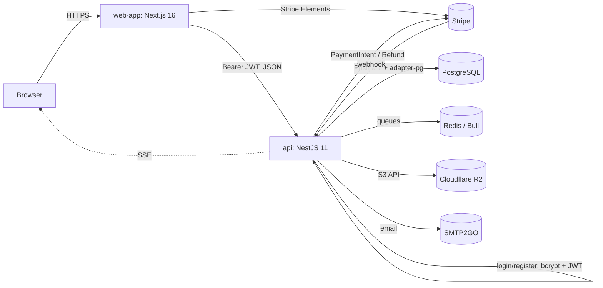
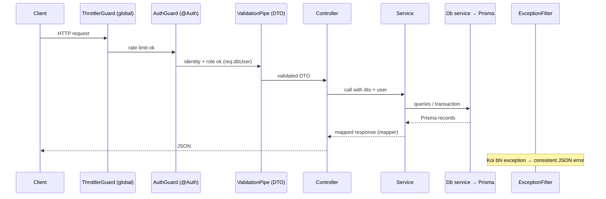
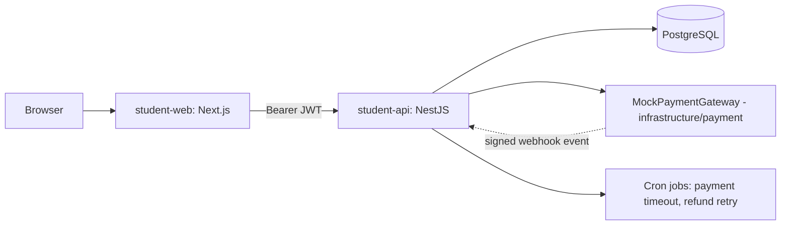

# 02 — System Architecture

## 1. High-level picture



**[VERIFIED]** Frontend aur backend alag deploy hote hain. Browser seedha backend ko call karta hai (`NEXT_PUBLIC_BASE_URL`) — Next.js beech mein proxy nahi karta. **[DESIGN]** Authentication poori tarah backend ka kaam hai: backend password hash/verify karta hai aur JWT issue karta hai; frontend sirf token store karke har request ke saath bhejta hai.

## 2. Backend architecture (`api/src`)

### 2.1 Folder layout (actual)

```text
src/
├── main.ts                     # helmet, CORS, ValidationPipe, global filter, Swagger (non-prod)
├── app.module.ts               # Config, Throttler, Bull, Schedule + saare domain modules
├── common/
│   ├── guards/                 # CustomThrottlerGuard, CustomerOnlyGuard
│   ├── pipes/                  # Image / multi-image / video validation (magic bytes)
│   ├── services/               # S3Service, FileUploadService
│   ├── money/ date/ period/    # MoneyService, DateService, DashboardPeriodService
│   ├── pagination/             # PaginationDto, buildMeta
│   ├── labels/                 # enum → human label maps
│   └── queue/                  # queue + job names
├── config/rate-limit.config.ts
├── filters/errors.exception.filter.ts
├── prisma/prisma.service.ts    # PrismaClient + PrismaPg adapter, lifecycle hooks
└── modules/<domain>/
    ├── controllers/            # thin REST controllers
    ├── services/               # business rules
    ├── db/                     # <domain>.db.service.ts — saari Prisma queries
    ├── dto/                    # class-validator request DTOs
    ├── types/                  # interfaces + <domain>.mapper.ts
    ├── openapi/                # Swagger response docs
    ├── cron/ processors/       # scheduled jobs / Bull workers (jahan zaroorat)
    └── <domain>.module.ts
```

### 2.2 Modules aur zimmedariyan

| Module | Responsibility |
|---|---|
| auth | Register, login, JWT sign/verify, password hashing, `JwtAuthGuard`, `RolesGuard`, `@Public()`, `@Roles()`, `@CurrentUser()` |
| user | Profile, admin create, status, addresses, preferences, self-delete |
| category, brand, supplier, products | Catalog |
| inventory, batch | Stock, adjustments, batches, expiry cron |
| cart | Shopping cart |
| order | Checkout transaction, status workflow, cancellations, payment timeout |
| payment | Stripe intents, webhooks (queue), refunds |
| notification, events | DB notifications, email queue, SSE |
| review | Product reviews |
| dashboard, audit, health | Admin insights, audit trail, liveness |

### 2.3 Request ki life



### 2.4 Background processing

| Mechanism | Kahan | Kya karta hai |
|---|---|---|
| `@Cron` (nestjs/schedule) | refund retry (5m), batch expiry (5m), order payment-timeout backstop (5m), notification cleanup | Periodic sweeps |
| Bull queues (Redis) | `email`, `notification`, `payment`, `order` | Webhook processing, delayed payment timeout, notification/email delivery (3 attempts, exponential backoff) |
| After-commit calls | `RefundService` | Refund / payment cancel DB commit ke baad; fail par `REFUND_PENDING` order retry cron uthata hai |

## 3. Frontend architecture (`web-app/src`)

```text
src/
├── app/                      # Next.js routes
│   ├── (auth)/login, register, forgot-password, check-email
│   ├── admin/<module>/page.tsx + (components)/   # admin pages, colocated components
│   ├── shop, cart-summary, checkout, checkout/payment, order-confirmation, profile
│   └── providers/providers.tsx                     # QueryClient, Toaster, AuthSync, SSE
├── components/ui/            # shadcn-style primitives (button, dialog, select, ...)
├── components/shared/        # InputField, Pagination, EmptyState, ErrorState, AuthGuard, ...
├── components/admin|customer # scope-specific reusable components
├── services/<domain>/        # index.ts (API calls), queries.ts, mutations.ts, types.ts
├── modules/zod/              # Zod schemas + inferred types
├── lib/api.ts                # saare endpoint URLs
├── lib/networking/request.ts # fetch wrapper + ApiError + token
├── lib/routes/routes.ts      # saare client routes
├── stores/                   # Zustand: auth-store (JWT + user), shop-store (cart)
└── hooks/                    # useAuthentication, useCheckout, useDebounce, ...
```

**Data flow:** Component → hook (`useGetX` / `useCreateX`) → `xService.method()` → `request()` → backend. Server state TanStack Query mein, client state (auth user, cart UI) Zustand mein.

## 4. Student project ka target architecture

Students same layering rakhein lekin external services kam karein:



Suggested backend tree (task ke recommended structure ke mutabiq):

```text
student-api/src/
├── main.ts, app.module.ts
├── config/env.validation.ts
├── common/{decorators,guards,filters,constants.ts,pagination}
├── database/{database.module.ts,database.service.ts,database.types.ts}
├── infrastructure/payment/{payment-gateway.ts,mock-payment.gateway.ts,payment-gateway.module.ts}
├── shared/money/money.service.ts
└── modules/{auth,users,addresses,categories,products,inventory,cart,orders,payments,health}/
    ├── dto/  types/  mappers/
    ├── <x>.controller.ts  <x>.service.ts  <x>.db.service.ts  <x>.module.ts
    └── <x>.service.spec.ts
```

Bade domains (orders) mein services alag karein: `order-creation.service.ts`, `order-cancellation.service.ts`, `order-status.service.ts`, `order-query.service.ts` — ek bada "god service" na banayein.

## 5. Architecture rules (summary)

1. Controller patla — sirf DTO lo, user lo, service call karo.
2. Business rules sirf service mein.
3. Prisma queries sirf `*.db.service.ts` mein (original ka established pattern).
4. External SDK (Stripe, S3, email) sirf apni infrastructure service mein.
5. Response hamesha mapper se — internal fields (`passwordHash`) kabhi bahar na jayein.
6. Ek transaction = ek business operation; side effects (email, notification) commit ke **baad**.
