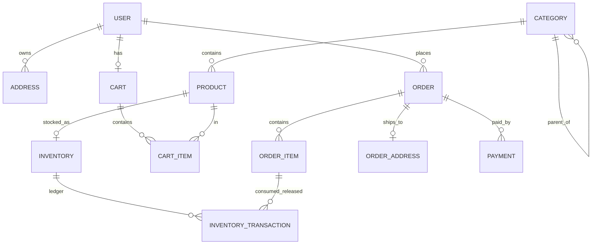

# 03 — Database Design

Database: **PostgreSQL**, ORM: **Prisma 7** (`prisma-client-js` generator + `@prisma/adapter-pg`). Schema: `api/prisma/schema.prisma`, migrations: `api/prisma/migrations/`.

## 1. Original schema — main tables

| Table | Purpose | Important constraints [VERIFIED] |
|---|---|---|
| `users` | Customers + admin | `email` unique, `passwordHash` (bcrypt), `phone` unique (nullable), `role` enum, `isActive`, `deletedAt` (anonymized), `totalOrders`, `totalSpent Decimal(10,2)` |
| `addresses` | Saved addresses | `(id, userId)` unique (ownership in one query), partial unique `userId WHERE isDefault = true` |
| `user_preferences` | push/email opt-in | `userId` unique |
| `categories` | Tree | `name`, `slug` unique, `parentId`, `depth`, materialized `path` |
| `brands`, `suppliers` | Catalog support | brand name/slug unique; supplier email/phone unique |
| `products` | Catalog | `slug`, `sku`, `barcode` unique; `@@unique([name, categoryId])`; FK category/brand `Restrict` |
| `product_images` | Max 3 images | index `(productId, sortOrder)` |
| `product_allergens` | Allergen declarations | `@@unique([productId, allergen])` |
| `inventory` | Per-product stock | `productId` unique, `stockStatus`, `qtyOnHand`, `lowStockThreshold` |
| `inventory_batches` | Expiry batches | `batchCode` unique, CHECK `qtyOnHand >= 0`, index `(productId, status, expiryDate)` for FEFO |
| `inventory_transactions` | Stock ledger | type enum, `orderItemId` link, index `(orderItemId, type)` |
| `carts`, `cart_items` | Cart | `carts.userId` unique, `@@unique([cartId, productId])` |
| `orders` | Orders | `orderNumber` unique (from `order_number_seq`), index `(status, paymentExpiresAt)` for timeout sweep |
| `order_items`, `order_addresses` | Order lines / address snapshot | `order_addresses.orderId` unique |
| `payments` | Gateway payments | `gatewayRef` unique |
| `notifications` | Inbox | `@@unique([userId, referenceId, referenceEvent])` |
| `reviews`, `review_images` | Reviews | `orderItemId` unique; `(reviewId, slot)` unique |
| `audit_logs` | Audit | indexes on status, createdAt, entity |

**Sequences [VERIFIED]:** `order_number_seq` (order number), `product_sku_seq` (SKU) — race-safe numbering, kyunke `MAX()+1` do parallel requests mein same number de sakta hai.

**Raw SQL constraints [VERIFIED]** (Prisma schema mein express nahi ho sakte, is liye migration SQL mein): partial unique default address, batch CHECK constraints, category top-level partial indexes (baad mein global unique se replace).

## 2. ER diagram (student project ke liye core)



## 3. Student project schema (recommended)

```prisma
enum UserRole { ADMIN CUSTOMER }
enum StockStatus { IN_STOCK LOW_STOCK OUT_OF_STOCK }
enum TransactionType { RECEIVED ADJUSTMENT_INCREASE ADJUSTMENT_DECREASE CONSUMED RELEASED }
enum AdjustmentReason { DAMAGE RECOUNT RETURN_TO_SUPPLIER MANUAL_CORRECTION RESTOCK }
enum OrderStatus { PENDING CONFIRMED PROCESSING READY_FOR_PICKUP READY_FOR_DELIVERY DELIVERED CANCELLED REFUND_PENDING }
enum PaymentStatus { UNPAID PAID FAILED CANCELED REFUNDED }
enum DeliveryType { DELIVERY PICKUP }

model User {
  id           String   @id @default(uuid())
  email        String   @unique @db.VarChar(255)
  passwordHash String                       // bcrypt hash — kabhi response mein nahi
  name         String   @db.VarChar(100)
  phone        String?  @unique @db.VarChar(20)
  role         UserRole @default(CUSTOMER)
  isActive     Boolean  @default(true)
  totalOrders  Int      @default(0)
  totalSpent   Decimal  @default(0) @db.Decimal(10, 2)
  createdAt    DateTime @default(now())
  updatedAt    DateTime @updatedAt
  @@map("users")
}

model Address {
  id String @id @default(uuid())
  userId String
  addressLine String @db.VarChar(100)
  city String @db.VarChar(30)
  county String @db.VarChar(30)
  postcode String @db.VarChar(20)
  isDefault Boolean @default(false)
  @@unique([id, userId])
  @@index([userId])
}

model Category { id, name @unique, slug @unique, isActive, parentId?, depth Int @default(0) }
model Product {
  id, name @db.VarChar(100), slug @unique, sku @unique, categoryId,
  price Decimal @db.Decimal(10,2), minimumOrderQuantity Int, maximumOrderQuantity Int, isActive Boolean
  @@unique([name, categoryId])
  @@index([categoryId, isActive])
}
model Inventory { id, productId @unique, qtyOnHand Int, lowStockThreshold Int @default(10), stockStatus }
model InventoryTransaction { id, inventoryId, type, quantity, reason?, note?, performedBy?, orderItemId?, createdAt
  @@index([orderItemId, type]) }
model Cart { id, userId @unique }
model CartItem { id, cartId, productId, quantity  @@unique([cartId, productId]) }
model Order { id, orderNumber @unique, userId, status, paymentStatus, deliveryType,
  subtotal, shippingCost, total (Decimal 10,2), pickupScheduledAt?, paymentExpiresAt,
  confirmedAt?, processedAt?, readyAt?, deliveredAt?, cancelledAt?, cancellationReason?, cancellationNote?
  @@index([userId, createdAt]) @@index([status, paymentExpiresAt]) }
model OrderItem { id, orderId, productId, quantity, price, subtotal }
model OrderAddress { id, orderId @unique, addressLine, city, county, postcode }
model Payment { id, orderId, gatewayRef @unique, amount, status, failureReason?, paidAt?, refundedAt? }
```

### 3.1 Raw SQL jo migration mein zaroor add karna hai

```sql
-- 1) SIRF EK ADMIN — database level par guarantee
CREATE UNIQUE INDEX "users_single_admin" ON "users" ("role") WHERE "role" = 'ADMIN';

-- 2) Stock kabhi negative nahi
ALTER TABLE "inventory" ADD CONSTRAINT "inventory_qty_non_negative" CHECK ("qtyOnHand" >= 0);

-- 3) Ek user ka max ek default address
CREATE UNIQUE INDEX "addresses_user_default_unique" ON "addresses" ("userId") WHERE "isDefault" = true;

-- 4) Race-safe order number
CREATE SEQUENCE "order_number_seq" START 1;
```

**Kyun?** Application-level "pehle check, phir insert" do parallel requests mein fail ho jata hai (dono check pass kar lete hain). Database constraint aakhri, guaranteed line of defence hai.

Migration banane ka tareeqa: `prisma migrate dev --create-only --name init` → generated SQL ke neeche upar wala SQL paste → `prisma migrate dev`.

## 4. Original se student schema mein changes

| Change | Kyun |
|---|---|
| `passwordHash` column (bcrypt) | Authentication backend khud karta hai |
| Sirf do roles (`ADMIN`, `CUSTOMER`) + single-admin index | Single admin requirement |
| Batches, images, allergens, brands, reviews, notifications nahi | Scope chhota |
| Cart item par `price` column nahi — price hamesha product se | Stale price ka masla hi khatam |

## 5. Transactions aur locking

| Operation | Isolation / lock | Kyun |
|---|---|---|
| Order create | Interactive `$transaction` + `SELECT ... FOR UPDATE` inventory rows, **productId order mein sorted** | Overselling aur deadlock dono se bachao |
| Stock adjustment | `FOR UPDATE` + CHECK constraint | Do admins ek saath adjust karein |
| Status change | `updateMany({ where: { id, status: expected } })` → `count === 0` → 409 | Optimistic concurrency |
| Payment confirm | `updateMany where status IN (UNPAID, FAILED)` + order `PENDING` | Duplicate webhooks |

## 6. Money

Hamesha `Decimal(10,2)` — kabhi `Float` nahi. Calculation `Prisma.Decimal` (ya integer pence) mein. `0.1 + 0.2 = 0.30000000000000004` wala masla JavaScript number mein hota hai; paise ke liye yeh accept nahi.

## 7. Deletion / archival policy

| Entity | Policy (original, [VERIFIED]) |
|---|---|
| User | Anonymize (soft) — orders bachane ke liye |
| Product/Category/Brand | Hard delete, lekin FK `Restrict` — order/cart reference ho to 409 |
| Order | Kabhi delete nahi — CANCELLED status |
| Cart items | Order create par delete |

Student project: product ko delete karne ke bajaye `isActive = false` (deactivate) prefer karein.

## 8. Indexes ka rule

Har woh column jo `WHERE`, `JOIN` ya `ORDER BY` mein baar baar aata hai us par index: `orders(userId, createdAt)`, `orders(status, paymentExpiresAt)`, `products(categoryId, isActive)`, `inventory_transactions(orderItemId, type)`. Unique constraints khud index bhi hote hain.
