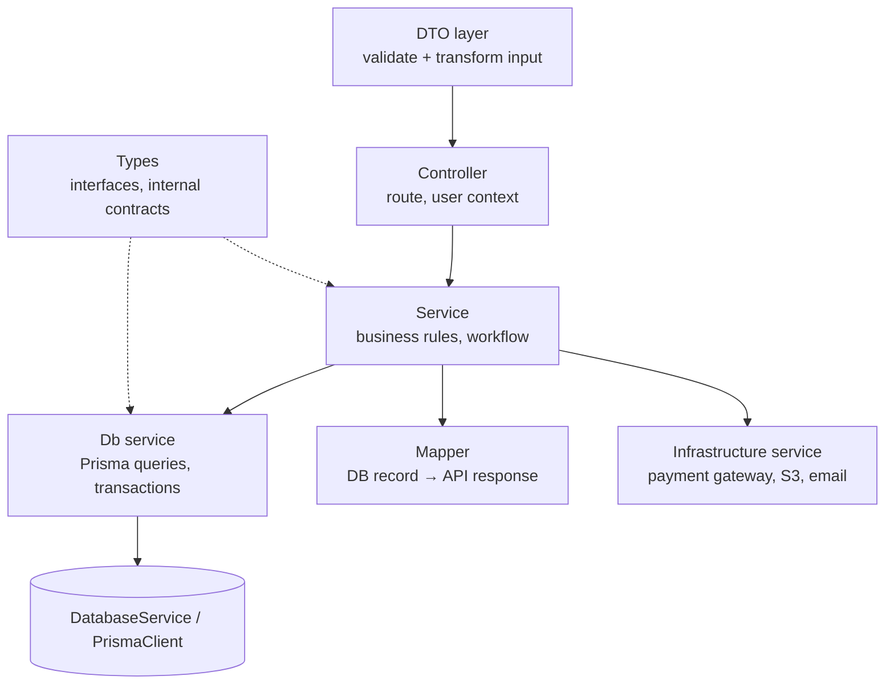

# 04 — Backend Development Guide (NestJS layers)

Technology same rakhein jo original mein hai: **NestJS 11 + Prisma 7 + PostgreSQL + class-validator**. Naya framework introduce na karein.

## 1. Layers ek nazar mein



| Layer | Kya karta hai | Kya **nahi** karta |
|---|---|---|
| DTO | Request shape, validation, transform | Business rules, DB |
| Controller | Route, `@Body/@Param/@Query`, current user, service call, status code | `if` business logic, Prisma |
| Service | Rules, workflow, transaction coordinate, doosri services call | Raw SQL / HTTP details |
| Db service | Prisma queries, `$transaction`, row locks, Prisma error → HttpException | Business decision |
| Types | Interfaces (`IOrder`), internal data (`ICreateOrderData`), Prisma payload types | Validation |
| Mapper | Decimal → string, nested shape, sensitive fields hatana | DB queries |
| Infrastructure | SDK init + calls (Stripe, S3, mailer) | Business rules |

## 2. DTO layer

**Original pattern [VERIFIED]** (`api/src/modules/order/dto/order.dto.ts`):

```ts
export class CreateOrderDto {
  @IsEnum(DeliveryType)
  deliveryType: DeliveryType;

  @IsUUID('4') @IsOptional()
  addressId?: string;

  @IsObject() @ValidateNested() @Type(() => OrderAddressDto) @IsOptional()
  shippingAddress?: OrderAddressDto;

  @IsDateString() @IsOptional()
  pickupScheduledAt?: string;

  @IsString() @IsOptional() @MaxLength(500)
  customerNotes?: string;
}
```

Rules:
- Create, update, query aur param ke **alag DTO**: `CreateProductDto`, `UpdateProductDto extends PartialType(CreateProductDto)`, `ListProductsQueryDto extends PaginationDto`, `ProductIdParamDto { @IsUUID() id }`.
- Prisma model ko kabhi DTO na banayein (warna `role`, `totalSpent` jaise fields client set kar sakta hai).
- Query string numbers ke liye `@Type(() => Number)`; booleans ke liye `@Transform(({ value }) => value === 'true')`.
- Global pipe: `whitelist: true, forbidNonWhitelisted: true, transform: true`.
- Cross-field rule (e.g. DELIVERY par address zaroori) DTO mein nahi — service mein (original bhi yahi karta hai).

## 3. Controller layer

```ts
@Throttle(RATE_LIMITS.ORDER)
@Auth('ADMIN')                 // class default
@Controller('orders')
export class OrderController {
  constructor(private readonly orderService: OrderService) {}

  @Post()
  @Auth('CUSTOMER')            // route override
  @HttpCode(HttpStatus.CREATED)
  createOrder(
    @Body() dto: CreateOrderDto,
    @CurrentDbUser() user: User,
  ) {
    return this.orderService.createOrder(dto, user);
  }
}
```

Rules:
- **Static routes pehle, `:id` routes baad mein** — `GET /orders/admin` ko `GET /orders/:id` shadow na kare (original comment yahi batata hai).
- User id hamesha token/guard se (`@CurrentDbUser()`), body se kabhi nahi.
- 204 wale endpoints (`DELETE`) par `@HttpCode(HttpStatus.NO_CONTENT)`.

## 4. Service layer

- Ek service ek responsibility. Original `OrderService` ~500 lines ka hai — student project mein orders ko split karein:

| Service | Kaam |
|---|---|
| `OrderCreationService` | Validation, `OrdersDbService.createOrderInTx` |
| `OrderCancellationService` | Customer/admin/system cancel — **ek shared** `cancelInTx` |
| `OrderStatusService` | Admin transitions map |
| `OrderQueryService` | History, detail, admin list |
| `PaymentsService` / `PaymentWebhookService` / `RefundService` | Payment lifecycle |

- Side effects (notification, audit, email) **commit ke baad**, fire-and-forget, apna error khud handle karein — taa ke notification fail hone se order fail na ho.
- Business failure → sahi exception: `BadRequestException` (rule toota), `NotFoundException`, `ConflictException` (race/duplicate), `ForbiddenException` (role).

## 5. Database service layer

- Har module ka `<domain>.db.service.ts` (original convention) jo shared `DatabaseService` (PrismaClient) inject kare.
- `DatabaseService` ek hi jagah bane (`database/database.service.ts`) — `onModuleInit` mein `$connect`, `onModuleDestroy` mein `$disconnect`.
- Multi-module transaction: db service methods `tx: Prisma.TransactionClient` accept karein (e.g. `refreshInventoryStatus(tx, inventoryId)` order aur inventory dono transactions mein reuse hota hai).
- Raw SQL sirf jab Prisma na kar sake (`FOR UPDATE`, sequences) — hamesha tagged template `$queryRaw\`...${value}\`` (parameterized). `$executeRawUnsafe` se bachein; original mein batch ids ke liye use hua hai sirf kyunke ids DB se aaye.
- Prisma error mapping: `P2002` → 409, `P2025` → 404, `P2003` → 409/400. (Original rule: unique error ke `meta.target` ko parse na karein — har call site par khud decide karein kaunsa field.)

```ts
// Example: guarded status update (optimistic concurrency)
async updateStatus(id: string, expected: OrderStatus, next: OrderStatus, data: object) {
  const { count } = await this.db.order.updateMany({
    where: { id, status: expected },
    data: { status: next, ...data },
  });
  if (count === 0) throw new ConflictException('Order status changed before update could complete');
}
```

## 6. Types layer

`types/<domain>.types.ts` mein:
- API response interfaces (`IOrder`, `IOrderSummary`) — money `string`.
- Internal contracts (`ICreateOrderData`, `ICancelOrderResult`).
- Constant maps (`ADMIN_ALLOWED_TRANSITIONS`, `CUSTOMER_CANCELLABLE_STATUSES`).
- Prisma payload types: `Prisma.OrderGetPayload<{ include: ... }>` — include object aur type ek saath define karein taa ke match rahein.

DTO = bahar se aane wala validated input. Type = andar ka contract. Dono ko mix na karein.

## 7. Mappers layer

```ts
export function toOrderSummary(order: PrismaOrderSummary, money: MoneyService): IOrderSummary {
  return {
    id: order.id,
    orderNumber: order.orderNumber,
    status: order.status,
    paymentStatus: order.paymentStatus,
    total: money.toDecimalString(order.total),   // Decimal → "12.50"
    itemCount: order._count.items,
    createdAt: order.createdAt,
  };
}
```

- User mapper `passwordHash` kabhi return na kare (original `IUser = Omit<User, 'lastLoginIp'>` aur deleted email prefix strip karta hai).
- Mapping logic ek jagah — controllers/services mein inline object na banayein.

## 8. Infrastructure services

| Original | Student |
|---|---|
| `common/services/s3.service.ts` + `FileUploadService.uploadAndPersist` (upload → persist → fail par rollback) | Optional |
| `payment/services/stripe.service.ts` | `infrastructure/payment/mock-payment.gateway.ts` implementing `PaymentGateway` interface (`createIntent`, `refund`, `signEvent`, `verifyEvent`) |
| `notification/services/smtp-provider.service.ts` | Optional |

Interface + injection token rakhein taa ke baad mein real Stripe gateway swap ho sake bina business code chhuye.

## 9. Common building blocks

- `common/decorators`: `@Public()`, `@Roles()`, `@CurrentUser()`.
- `common/guards`: `JwtAuthGuard` (global), `RolesGuard`.
- `common/filters/all-exceptions.filter.ts`: consistent error JSON, no stack.
- `common/pagination`: `PaginationDto` (page ≥1, limit 1–100), `buildMeta(total, page, limit)` → `{ total, currentPage, limit, pages, hasNextPage, hasPrevPage }`.
- `shared/money/money.service.ts`: `lineItemTotal`, `sumItems`, `calculateOrderTotal`, `toDecimalString`.
- `config/env.validation.ts`: boot par env validate.

## 10. File size rule

Koi source file 1000 lines se zyada nahi. Original mein `order.db.service.ts` (690) aur `products.dto.ts` (415) bade hain lekin limit ke andar; split ka signal: file mein do alag zimmedariyan ho jayein.

## 11. Logging aur config

- `new Logger(ClassName.name)` har class mein; log mein ids (orderId, userId), kabhi passwords/tokens nahi.
- `ConfigModule.forRoot({ isGlobal: true, validate })`; `process.env` sirf config layer mein.
