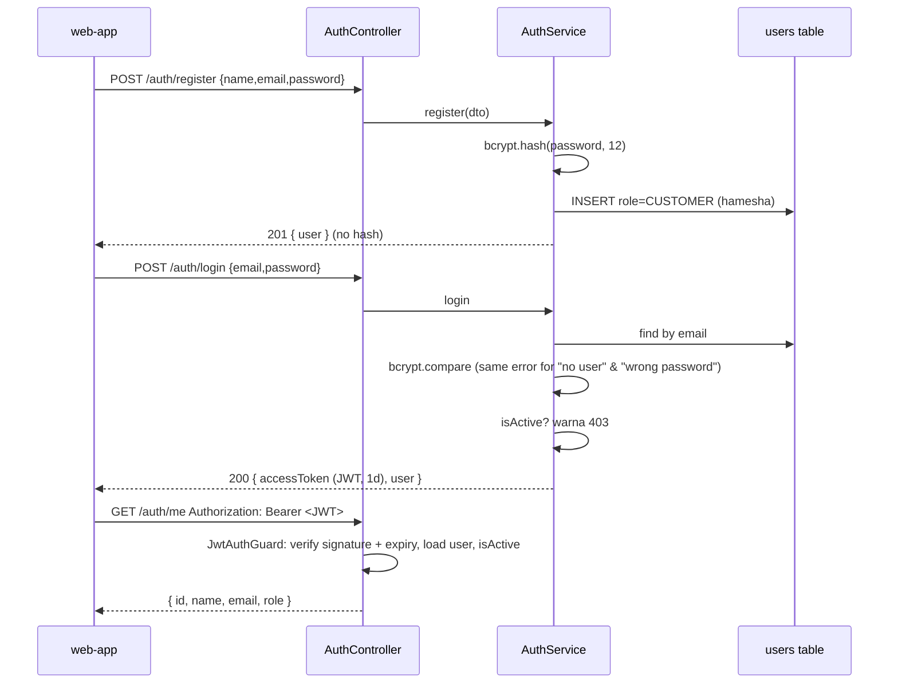

# 06 — Authentication aur Authorization

> **Authentication** = "yeh kaun hai?" (identity). **Authorization** = "kya yeh is kaam ki ijazat rakhta hai?" (permission). Guard identity establish karta hai; role check aur ownership check permission decide karte hain.

**[DESIGN]** Is project mein authentication **poori tarah backend handle karta hai** — registration, password hashing (bcrypt), login, aur JWT access token issue/verify. Koi external identity provider nahi hai.

## 1. Mechanism

| Piece | Kahan (suggested) | Kaam |
|---|---|---|
| `AuthController` | `api/src/modules/auth/auth.controller.ts` | `POST /auth/register`, `POST /auth/login`, `GET /auth/me` |
| `AuthService` | `auth.service.ts` | Register (hash + insert CUSTOMER), login (compare + sign JWT) |
| `PasswordService` | `password.service.ts` | `bcrypt.hash` / `bcrypt.compare` (cost 12) |
| `JwtModule` | `auth.module.ts` | `@nestjs/jwt`, secret `JWT_SECRET`, expiry `JWT_EXPIRES_IN` |
| `JwtAuthGuard` (global) | `common/guards/jwt-auth.guard.ts` | Token verify + DB user + `isActive` |
| `RolesGuard` (global) | `common/guards/roles.guard.ts` | `@Roles('ADMIN')` check |
| `@Public()` | `common/decorators/public.decorator.ts` | Guard skip (catalog, register, login, webhook) |
| `@CurrentUser()` | `common/decorators/current-user.decorator.ts` | `req.user` controller mein |
| `CustomerOnlyGuard` / `@Roles('CUSTOMER')` | | Cart sirf customer (admin → 403) |
| Frontend token store | `web-app/src/stores/auth-store.ts` | `{ token, user }` Zustand persist |
| `request()` | `web-app/src/lib/networking/request.ts` | `Authorization: Bearer <token>` lagata hai; 401 par logout |
| `AuthGuard` (frontend) | `web-app/src/components/shared/AuthGuard.tsx` | Admin/customer layouts ki route protection |

## 2. Roles aur permissions

| Role | Kya kar sakta hai |
|---|---|
| CUSTOMER | Apni profile, addresses, cart, orders, payments, reviews, notifications |
| ADMIN | Catalog, inventory, orders fulfilment/cancel, customers list, customers activate/deactivate, reviews moderation, dashboard |

Project mein sirf yeh **do roles** hain — teesra role nahi.

Ownership checks [VERIFIED reference code]: orders `findFirst({ id, userId })`, addresses composite `(id, userId)`, cart item ↔ user cart match, reviews `existing.userId !== user.id → 403`, notifications userId scoped.

## 3. Flow



## 4. Rules

1. **Password storage:** `bcryptjs` hash, cost 12. Plain password kabhi log/DB/response mein nahi.
2. **Password policy:** min 8 chars (register Zod ke mutabiq), max 72 (bcrypt limit).
3. **Login error:** dono cases ("email nahi mila", "password ghalat") mein same **401** `Invalid email or password` — user enumeration se bachao.
4. **JWT payload:** `{ sub: userId, role }` — sirf identifiers, koi secret/PII nahi. Secret `JWT_SECRET` (≥32 random chars) env se. Expiry `JWT_EXPIRES_IN` (e.g. `1d`).
5. **Har request par DB check:** user exist kare aur `isActive` ho — deactivate karte hi purana token bekaar. Role bhi DB se lo, token se nahi (role badle to foran asar).
6. **Rate limit** login/register: 10/min per IP.
7. **Logout:** client token delete kare. **[RECOMMENDED]** Server-side revocation chahiye ho to `tokenVersion` column: logout/password-change par increment, guard token ke `ver` ko compare kare.
8. **Refresh tokens:** scope mein nahi — expiry par 401 → frontend logout + login page. **[RECOMMENDED]** Production mein short-lived access token + httpOnly cookie refresh token.
9. **Password reset / email verification:** scope mein nahi. **[RECOMMENDED]** Agar banana ho to: random token generate karo, sirf us ka hash DB mein rakho, expiry 15–60 min, ek dafa use.

## 5. Single admin — teen layers

| Layer | Kya | Kyun |
|---|---|---|
| API | `POST /auth/register` DTO mein `role` field hi nahi; service hamesha `CUSTOMER` likhe; `forbidNonWhitelisted` extra field par 400 | Customer khud admin na ban sake |
| Application | Koi endpoint role change nahi karta; admin sirf seed script (`ADMIN_EMAIL`, `ADMIN_PASSWORD`, `ADMIN_NAME` env) se banta hai — password bcrypt hash hota hai; seed "agar admin pehle se hai to skip" | Accidental doosra admin na bane |
| Database | `CREATE UNIQUE INDEX users_single_admin ON users(role) WHERE role = 'ADMIN';` | Do parallel seeds / manual SQL bhi doosra admin na bana sakein |

Admin deactivate nahi ho sakta (`PATCH /admin/customers/:id/status` sirf CUSTOMER targets, apne aap par 400).

## 6. Guards

```ts
// Global JwtAuthGuard — deny by default; @Public() se opt-out
@Injectable()
export class JwtAuthGuard implements CanActivate {
  async canActivate(ctx: ExecutionContext) {
    if (this.reflector.getAllAndOverride<boolean>(IS_PUBLIC_KEY, [ctx.getHandler(), ctx.getClass()])) return true;
    const req = ctx.switchToHttp().getRequest();
    const token = extractBearer(req.headers.authorization);        // missing → 401
    const payload = await this.jwt.verifyAsync(token);              // invalid/expired → 401
    const user = await this.users.findAuthUser(payload.sub);        // not found → 401
    if (!user.isActive) throw new ForbiddenException('User account is deactivated');
    req.user = user;                                                // { id, role, name, email }
    return true;
  }
}

// RolesGuard — @Roles('ADMIN')
if (required && !required.includes(req.user.role)) throw new ForbiddenException('Insufficient permissions');
```

> Reference code mein guard har route par `@Auth()` se lagta hai (opt-in) — code comment khud "deny-by-default not yet implemented" kehta hai. Is project mein **global guard** rakhein: koi naya route bhool se public nahi hoga.

## 7. Ownership (IDOR protection)

Customer URL mein id badal kar doosre ka data na dekh sake:

```ts
// GALAT: sirf id se dhoondna
this.db.order.findUnique({ where: { id } });
// SAHI: id + userId
this.db.order.findFirst({ where: { id, userId: user.id } });  // na mile → 404
```

Mutations bhi scoped: `updateMany({ where: { id, userId, status: { in: allowed } } })`.

## 8. Permission matrix

| Endpoint group | Guest | CUSTOMER | ADMIN |
|---|---|---|---|
| `POST /auth/register`, `/auth/login` | ✅ | ✅ | ✅ |
| `GET /auth/me` | ❌ 401 | ✅ | ✅ |
| `GET /categories`, `GET /products(/:id)` (active only) | ✅ | ✅ | ✅ |
| `/addresses/*`, `/cart/*`, `POST /orders`, `/orders/me*`, `/payments/*` | ❌ | ✅ own | ❌ 403 |
| `/admin/*` (categories, products, inventory, orders, customers) | ❌ | ❌ 403 | ✅ |
| `POST /webhooks/payments/mock` | signature only | | |

## 9. Frontend route protection

`AuthGuard expectedRole="ADMIN"|"CUSTOMER"` layouts mein mount hota hai: store hydrate hone ka wait (`_hasHydrated`) → token na ho to `/login` → `GET /auth/me` se role verify → mismatch ya 401/403 par store clear + `/login`. Network/5xx errors par logout **nahi** karta (transient errors user ko bahar na nikalein — reference `AuthGuard` ka yahi rule hai).

> **Yaad rakhein:** Frontend guard sirf UX hai (galat page na dikhe). Asli security backend guard + ownership checks hain. Har protected endpoint ko Postman/curl se bina token aur doosre user ke token se test karein.

## 10. Expired / invalid credentials

| Case | Backend | Frontend |
|---|---|---|
| Token missing | 401 `Authorization header missing` | Login page |
| Token expired | 401 `Token has expired. Please login again.` | Store clear, login, toast |
| User deactivated | 403 | Toast "Account deactivated", logout |
| Wrong role | 403 | Redirect to apna area |
| Wrong password | 401 generic | Form error toast |
