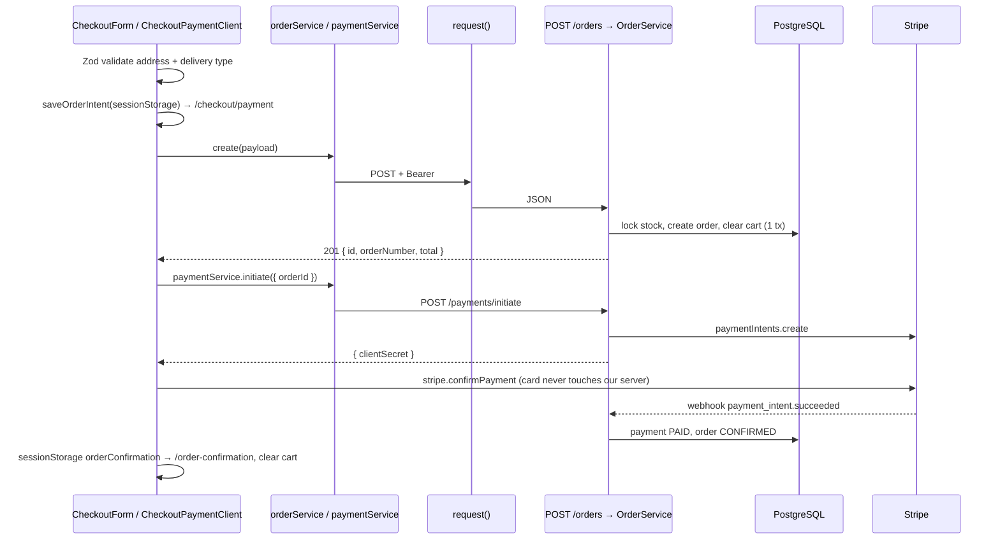

# 08 — API Integration Guide (Frontend ↔ Backend)

Yeh guide `web-app` ka **actual** API pattern samjhati hai. Token backend ke `POST /auth/login` se milta hai (JWT) aur frontend auth store mein rehta hai.

## 1. API client kahan configure hai?

Do files [VERIFIED]:

- `web-app/src/lib/api.ts` — saare URLs:

```ts
const BASE_URL = process.env.NEXT_PUBLIC_BASE_URL || "http://localhost:8080";

export const API_ENDPOINTS = {
  cart: { get: `${BASE_URL}/cart`, items: `${BASE_URL}/cart/items`, item: (id: string) => `${BASE_URL}/cart/items/${id}` },
  order: { create: `${BASE_URL}/orders`, list: `${BASE_URL}/orders`, detail: (id: string) => `${BASE_URL}/orders/${id}`,
           cancel: (id: string) => `${BASE_URL}/orders/${id}/cancel` },
  payment: { initiate: `${BASE_URL}/payments/initiate` },
  // ...
} as const;
export const ADMIN_API_ENDPOINTS = { order: { list: `${BASE_URL}/orders/admin`, /* ... */ } } as const;
```

- `web-app/src/lib/networking/request.ts` — ek `fetch` wrapper `request<T>(url, data, options)`.

## 2. Base URL kaise manage hota hai?

`NEXT_PUBLIC_BASE_URL` env (e.g. `http://localhost:4000/v1`). `NEXT_PUBLIC_` prefix ka matlab yeh browser bundle mein jayega — is mein kabhi secret na rakhein.

## 3. Token kaise attach hota hai?

Har service function khud token leta hai aur `request()` ko deta hai:

```ts
export const orderService = {
  create: async (payload: ICreateOrderPayload): Promise<IOrderApiResponse> => {
    const token = getAuthToken();                             // auth store ka JWT
    const response = await request<IOrderApiResponse>(API_ENDPOINTS.order.create, payload, {
      method: "POST",
      contentType: "application/json",
      token,                                                  // → Authorization: Bearer <token>
    });
    return response.data!;
  },
};
```

`getAuthToken()` login ke waqt save hua JWT auth store se uthata hai; token na ho to `AuthTokenMissingError`:

```ts
export function getAuthToken(): string {
  const token = useAuthStore.getState().token;
  if (!token) throw new AuthTokenMissingError();
  return token;
}
```

## 4. Request/response typing

`services/<domain>/types.ts` mein backend response ka exact TypeScript type (`IOrderApiResponse`, `ICartApiResponse`). `request<T>()` generic hai. Money fields `string` type ke hain kyunke backend string bhejta hai.

## 5. API functions ki organization

```text
services/orders/
  index.ts       → orderService = { create, listCustomer, getCustomerDetail, cancelCustomer, listAdmin, updateStatus, ... }
  types.ts       → request/response interfaces
  queries.ts     → useGetCustomerOrders, useGetAdminOrderDetail + customerOrderKeys / adminOrderKeys
  mutations.ts   → useCancelOrder, useUpdateOrderStatus (toast + cache invalidation)
```

Naming: `useGet*`, `useCreate*`, `useUpdate*`, `useDelete*`.

## 6. Server errors kaise handle hote hain?

`request()` non-2xx par `ApiError(status, message)` throw karta hai. `extractApiMessage` NestJS ke har shape se readable message nikalta hai: `message` string, `message[]` (validation — join), nested `message.message`, `errors[]`, aur `error` (generic labels jaise "Bad Request" ignore). Timeout (`timeoutMs` opt-in, uploads ke liye) → `ApiError(408)`.

Components mein:

```ts
onError: (error: Error) => toastError("Failed to cancel order", error.message)
```

Specific handling (original `CheckoutPaymentClient`): `409` → "Duplicate request", message mein "Not enough stock" → "Out of stock" toast, "Cart is empty" → shop par redirect.

## 7. Loading, error, empty, success display

```tsx
const { data, isLoading, isFetching, isError, error } = useGetCustomerOrders({ page, limit: 10 });

if (isLoading) return <OrderTableSkeleton />;
if (isError) return <ErrorState message={error.message} />;
if (!data?.data.length) return <EmptyState title="No orders yet" message="Your orders will appear here." />;
return <OrderTable orders={data.data} isFetching={isFetching} />;
```

## 8. Duplicate requests kaise roke jate hain?

Teen alag concerns — inhein mix na karein:

| Concern | Kya hai | Original mein kahan |
|---|---|---|
| **Deduplication** (read) | Same query key ke parallel calls ek request ban jate hain | TanStack Query automatically; `staleTime: 5 min`, `retry: 1` (`providers.tsx`) |
| **Caching** | Data dobara fetch kiye baghair dikhana | Query cache + `keepPreviousData` |
| **Submit protection** (UI) | Button disable while pending | `disabled={isSubmitting / isPending}` |
| **Debounce** | Spam clicks ek write | Cart +/- 350 ms debounce per item (`stores/shop-store.ts`); search `useDebounce` |

> Button disable karna sirf UX protection hai. Backend phir bhi apne rules (unique constraints, status guards, cart khali check) se duplicate writes rokta hai — dekhein [11 §2](11-performance-and-reliability.md).

**[VERIFIED gap]** `services/payments/index.ts` har initiate call par naya `crypto.randomUUID()` banata hai — retries key share nahi karte. Student project mein key caller se pass karein (order create ki tarah).

## 9. Query caching aur invalidation

Query keys object mein:

```ts
export const customerOrderKeys = {
  all: ["customerOrders"] as const,
  paginated: (p: IFetchCustomerOrdersPayload) => ["customerOrders", "list", p] as const,
  detail: (id: string) => ["customerOrders", "detail", id] as const,
};
```

Mutation ke baad:

```ts
export function useAddCartItem() {
  const qc = useQueryClient();
  return useMutation({
    mutationFn: (p: IAddCartItemPayload) => cartService.addItem(p),
    onSuccess: () => qc.invalidateQueries({ queryKey: cartKeys.cart }),
  });
}
```

Admin order mutations error par bhi `refetchQueries(["adminOrders"])` karte hain — kyunke 409/400 ka matlab aksar cache stale hai (doosre admin ne status badal diya).

| Mutation | Invalidate |
|---|---|
| Cart add/update/remove | `["cart"]` |
| Order create | `["cart"]`, `["customerOrders"]` |
| Customer cancel | `["customerOrders"]` |
| Admin status/cancel | `["adminOrders"]` |
| Product create/update | `["products","list"]`, `productKeys.detail(id)` |

## 10. Forms validated data kaise submit karte hain?

Zod schema → `zodResolver` → `handleSubmit(onSubmit)` sirf valid data deta hai → `mutation.mutate(data)` ya service call. Form type `z.infer<typeof schema>`; API payload type alag ho sakta hai (e.g. form `fullName`, API `name`) — mapping submit handler mein.

## 11. Pagination, filters, search

`URLSearchParams` sirf defined values ke saath:

```ts
const params = new URLSearchParams();
if (payload.page) params.set("page", String(payload.page));
if (payload.status) params.set("status", payload.status);
if (payload.search) params.set("search", payload.search);
const url = `${API_ENDPOINTS.order.list}${params.toString() ? `?${params}` : ""}`;
```

Filter badle to `setPage(1)` (original `ProductsView`). Payload object query key mein jata hai, is liye har filter combination ka alag cache.

## 12. Protected frontend routes

- Layout `AuthGuard expectedRole` + `ProtectedRoute` (checkout).
- Student: `AuthGuard` client component layout mein — store hydrate hone ka wait (`_hasHydrated`), token na ho → `/login`, `GET /auth/me` role mismatch → redirect.

## 13. Logout aur auth failures

- Logout: auth store se token + user clear (`logout()`) + `resetCartLocal()` + `router.push(login)`.
- `AuthGuard` sirf **401/403** par logout karta hai; network error, 429, 5xx par nahi (transient).
- Student: `request()` mein 401 aaye to `useAuthStore.getState().logout()`.

## 14. Environment variables

| Var | Kaam |
|---|---|
| `NEXT_PUBLIC_BASE_URL` | Backend URL |
| `NEXT_PUBLIC_STRIPE_PUBLISHABLE_KEY`, `NEXT_PUBLIC_GOOGLE_MAPS_API_KEY` | Public keys (optional features) |

Frontend ke paas koi auth secret nahi hota — `JWT_SECRET` sirf backend `.env` mein. Student `.env.example`: `NEXT_PUBLIC_API_URL=http://localhost:4000/v1` — bas.

## 15. API integration testing

Original frontend mein koi test nahi [VERIFIED]. Student project: Vitest + MSW (mock server) se service functions aur hooks test karein — dekhein [12-testing-strategy.md](12-testing-strategy.md).

## 16. Complete trace — "Place order & pay"



Initiate fail ho to UI order ko `PATCH /orders/:id/cancel { reason: "OTHER" }` se cancel karta hai (stock wapas). Student version mein Stripe ki jagah `POST /payments/:id/mock-complete { outcome }`.
