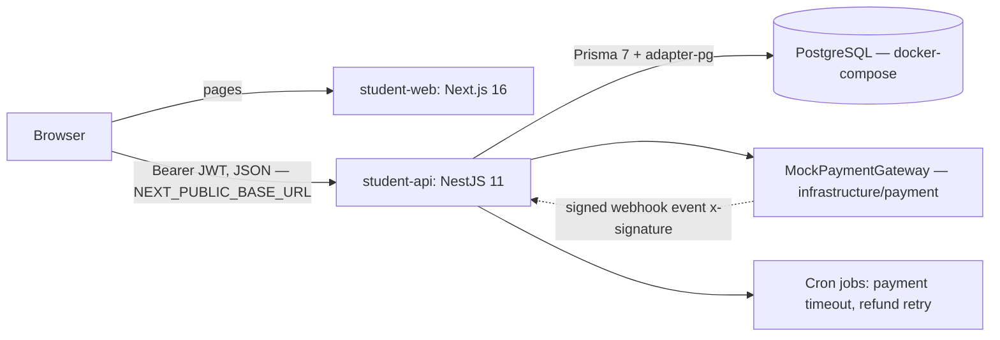
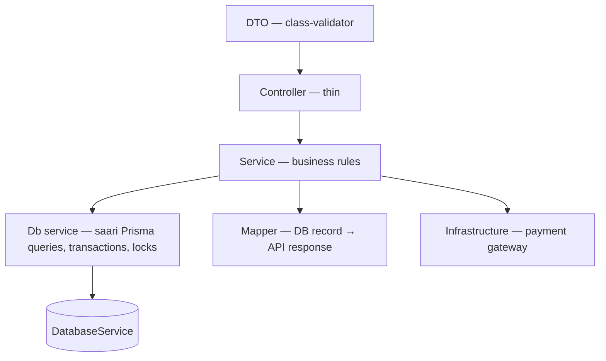
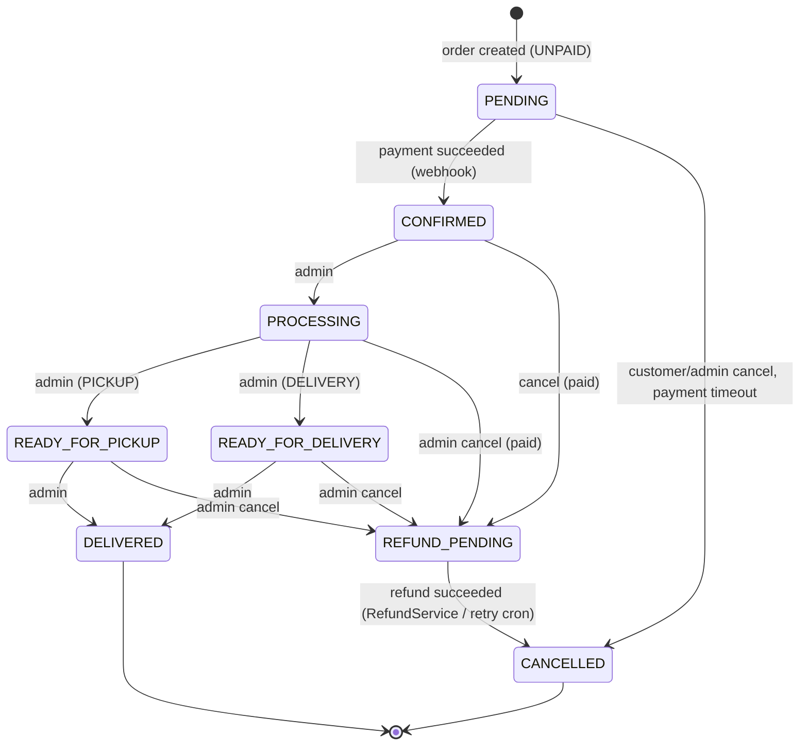
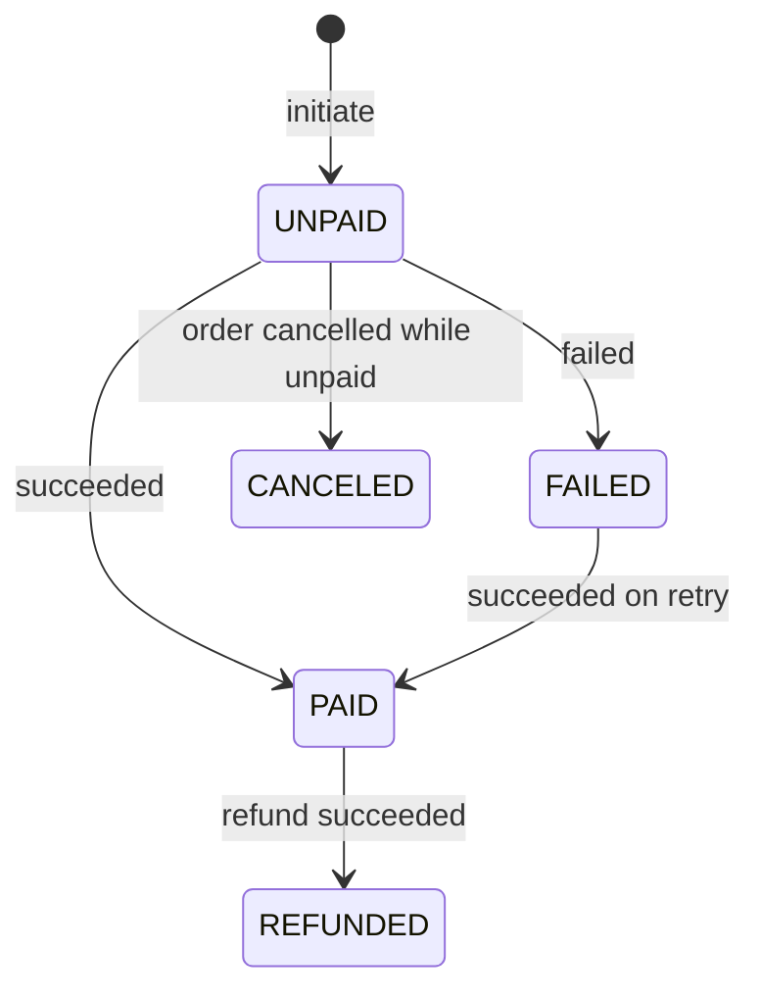
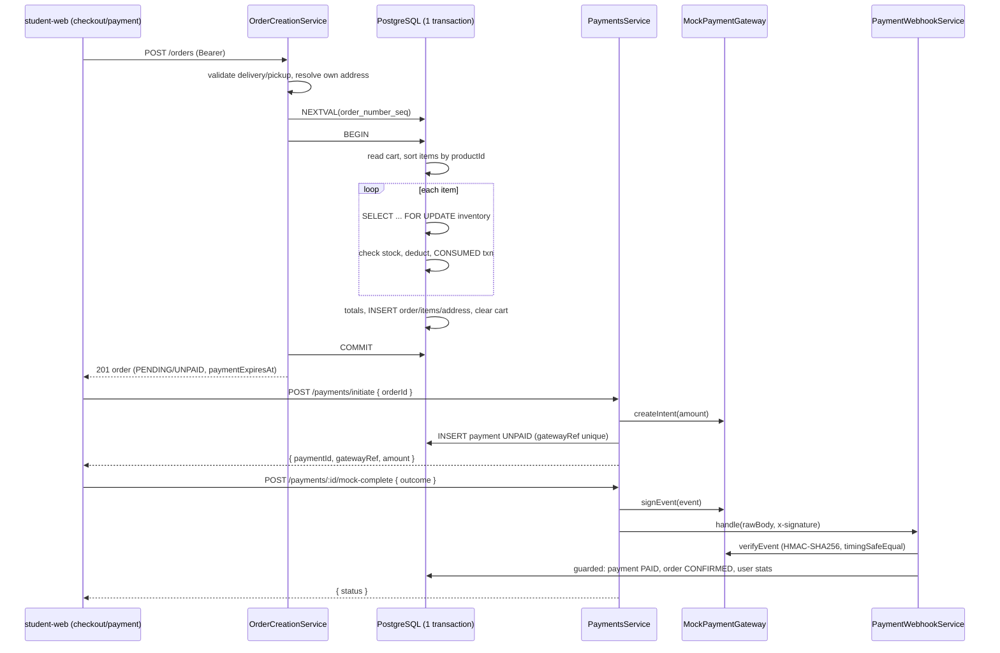
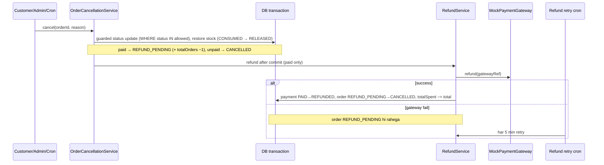

# OnlineMart — Architecture (Phase 2)

> Source: `FLOW-MD/02-system-architecture.md`, `04`, `06`, `01 §14–20`.

## 1. Context diagram

- Frontend aur backend alag apps hain. Browser seedha backend ko call karta hai (Next.js proxy nahi karta).
- Authentication poori tarah backend ka kaam: bcrypt hash/verify + JWT issue/verify. Frontend sirf token store karke `Authorization: Bearer` bhejta hai.
- Koi Redis/queue nahi — background kaam `@nestjs/schedule` cron se.

## 2. Backend modules (`student-api/src`)

| Module / folder | Zimmedari |
|---|---|
| `config/` | Env validation (boot par fail-fast) |
| `database/` | Ek `DatabaseService` (PrismaClient + adapter-pg), lifecycle hooks |
| `common/` | `@Public`, `@Roles`, `@CurrentUser`, `JwtAuthGuard` (global), `RolesGuard` (global), exception filter, pagination |
| `shared/money/` | `MoneyService` — Decimal/pence arithmetic, `"12.50"` strings |
| `infrastructure/payment/` | `PaymentGateway` interface + `MockPaymentGateway` (`createIntent`, `refund`, `signEvent`, `verifyEvent`) |
| `modules/health` | `GET /health` |
| `modules/auth` | Register, login, me, password hashing, JWT |
| `modules/users` | Admin customer list + status, admin seed support |
| `modules/addresses` | Address book (ownership, single default) |
| `modules/categories` | Category tree (2 levels, leaf rule) |
| `modules/products` | Admin CRUD + public catalog (active only) |
| `modules/inventory` | Stock, adjustments (row lock), ledger, stock status |
| `modules/cart` | Customer cart (limits checked in transaction) |
| `modules/orders` | `OrderCreationService`, `OrderCancellationService`, `OrderStatusService`, `OrderQueryService`, payment-timeout cron |
| `modules/payments` | `PaymentsService`, `PaymentWebhookService`, `RefundService`, refund-retry cron |

### Layers (har module)

Rules: controller mein business logic / Prisma nahi; Prisma sirf `*.db.service.ts` mein; response hamesha mapper se (`passwordHash` kabhi bahar nahi); side effects commit ke baad.

### Sync vs async

| Kaam | Kaise |
|---|---|
| Register, login, CRUD, cart, order create, status change, cancel | Sync HTTP request + DB transaction |
| Mock payment confirm/fail | `mock-complete` → gateway signed event → webhook handler (wahi code jo `POST /webhooks/payments/mock` chalata hai) |
| Refund | Cancel commit ke baad `RefundService`; fail ho to refund-retry cron (har 5 min) |
| Payment timeout | Cron har minute — `PENDING` + `paymentExpiresAt < now` |

## 3. Frontend (`student-web/src`)

| Folder | Kaam |
|---|---|
| `app/` | Routes — `page.tsx` sirf compose karta hai, `(components)/` mein page ke components |
| `components/ui` | shadcn primitives |
| `components/shared` | `InputField`, `Pagination`, `EmptyState`, `ErrorState`, `StatusBadge`, `AuthGuard`, ... |
| `components/admin`, `components/customer` | Scope-specific components |
| `services/<domain>/` | `index.ts` (API calls), `types.ts`, `queries.ts`, `mutations.ts` |
| `modules/zod/` | Zod schemas + inferred types |
| `lib/api.ts`, `lib/routes/routes.ts`, `lib/config.ts`, `lib/networking/request.ts` | URLs, client routes, env, fetch wrapper |
| `stores/` | Zustand: `auth-store` (JWT + user), `shop-store` (cart UI) |

Data flow: Component → hook (`useGetX` / `useCreateX`) → `xService.method()` → `request()` → backend. Server state TanStack Query mein; client state Zustand mein.

## 4. Order state machine (01 §19)

## 5. Payment state machine

## 6. Checkout sequence

## 7. Cancel + refund sequence

